# VB Harness

**Proof-first coding with local models.** Models write code; your project's own checks decide whether it
survives.

VB Harness is an engineering harness that makes local coding agents accountable for their changes. It doesn't try to
make the model smarter: it breaks your request into small tasks, has the model write each one in an isolated copy,
and keeps a change only when your type check, lint, build and tests pass and an independent review can't prove it
wrong.

[![An animated walkthrough of an agent-mode run in the app: Check setup lists every check as passing, a four-part blog request is sent with Start build, an agent investigates the repository and the plan is checked, the build card moves through Plan, Tasks, Final checks, Review and Report while four tasks are worked by agents and a note is sent to steer them, the model answers the checks caught are listed with plain reasons, the evidence-gated review stops three unproven claims, and the finished blog pages are shown next to the code that built them](docs/media/demo-preview.webp)](docs/media/demo.mp4)

*A four-part blog feature, built by a local model on a 6 GB laptop GPU in one unattended run. An animated
illustration of a real run (not a screen recording): the plan, code, numbers, review claims and pages come from a
real agent-mode run of evaluation task 10, which took 3 hours 28 minutes. The steering note shows the feature and was
not part of that run, and the pages are shown in a layout with cover art made for the video; the run's own files are
unchanged. Click it for the 1080p, 60 fps video.*

- **Your checks decide, not the model.** Every change runs your type check, lint, build and tests. A change that
  breaks one goes back to the model with the exact errors, and only a green change is committed.
- **Claims need proof.** The final review may only report a bug it can show with a failing test; unproven claims are
  dropped, so the report holds no invented problems.
- **Your checkout is never touched.** Work happens in its own worktree on a new branch: no pushes, no installs
  without your OK, git hooks off. You review the branch like any pull request.
- **Built for small models.** Small tasks, exact edits instead of whole files, JSON checked on every reply, and
  context fitted to the model's window. Any OpenAI-compatible server works: LM Studio, Ollama, llama.cpp, vLLM.
- **Small, verifiable tasks.** A feature becomes a plan of small tasks, each with the files it may touch and how it
  will be proved; the plan is checked before any code is written.
- **You see what it cost.** Every model call is counted by role (planner, implementer, fixer, reviewer), so you know
  where the time and tokens went.
- **Nothing to install but Ruby.** Zero gem dependencies; the harness is plain Ruby and git.
- **A calm app for all of it.** Plan in Chat and watch the model think, start a build, steer it with a note, preview
  the result, even from your phone.

Get real coding work out of the model on your own machine. The harness plans a feature as small tasks, has your
local model implement them one at a time, proves every change with your project's own type check, lint, build and
tests, and re-reviews what it built with an evidence gate. It is built around the weak spots of local models:
hallucinated APIs and defects, wrong edits, broken JSON, and small context windows.

AstroJS is the first supported stack. Any OpenAI-compatible endpoint works: LM Studio, Ollama, llama.cpp's server,
vLLM, or a hosted API.

**Documentation: [vb-harness.vandbruno.net](https://vb-harness.vandbruno.net)**, with the guides, the cookbook and the design
decisions.

**Status: early development.** Everything below works and is tested, but expect rough edges and changes.

## Never coded? Build your own website

You don't need to write code: you describe the website in plain words, a model on your own computer builds it, and
one click shows it in your browser. Setup takes about 30 minutes, once.

1. **Install LM Studio** from [lmstudio.ai](https://lmstudio.ai/). It runs AI models on your computer.
   Pick a video for the next two steps: a [quick LM Studio setup](https://www.youtube.com/watch?v=396Xg5ZSL80), or
   [Web Dev Simplified's friendly intro to running AI locally](https://www.youtube.com/watch?v=UngVdAsQEiU).
2. **Download a coding model** in LM Studio's **Discover** tab (the models come from
   [Hugging Face](https://huggingface.co/models?library=gguf&sort=trending)). Pick one that fits your computer's
   memory; LM Studio marks the ones that fit.
3. **Start LM Studio's server** in its **Developer** tab, and leave LM Studio open.
4. **Download VB Harness:** on GitHub, **Code → Download ZIP**, and unzip it (on Windows, right-click the ZIP →
   **Extract All…**; on a Mac, double-click it).
5. **Double-click Start VB Harness** in the unzipped folder: `Start VB Harness.bat` on Windows,
   `Start VB Harness.command` on a Mac. A small window checks for the three free tools VB Harness needs (Ruby,
   Git, and Node.js for the website itself). For each one that is missing it says what it is for and asks before
   installing it, from the official source: winget on Windows, Apple's Command Line Tools and
   [Homebrew](https://brew.sh/) on a Mac. If it can't install one, it opens the official download page. Then the
   app opens in your browser. Keep that small window open while you use the app; closing it stops VB Harness.
6. **In the app:** **Models** finds LM Studio, choose **Use**. Then **Add project → New Astro site**, switch the text
   box to **Build**, describe your website ("a page for my bakery with opening hours and a menu…") and choose
   **Start build**. When it's done, **Preview** shows your site.

If something is missing, the app says what and usually offers a **Fix** button. Local models make mistakes, so look
over the result before you publish it.

**If your computer warns you about the start file.** It came from the internet, so your computer asks before
running it. That is normal; the steps below are the system's own way to say yes, and nothing is switched off.

- **Windows:** if a blue box says *Windows protected your PC*, choose **More info → Run anyway**. When an installer
  asks *Do you want to allow this app to make changes to your device?*, choose **Yes**. If Smart App Control blocks
  the file and offers no way to run it, use the manual steps below instead; Smart App Control can also block Ruby
  itself on some computers.
- **Mac:** if it says it can't verify the file is free of malware, choose **Done**, then open **System Settings →
  Privacy & Security**, scroll down and choose **Open Anyway** next to "Start VB Harness.command" (on older macOS,
  right-click the file and choose **Open**). If Terminal asks to access your Downloads or Desktop folder, choose
  **Allow**. Installing Homebrew asks for your Mac password; that is the installer asking, not VB Harness.
- **After installing a tool,** the window may ask you to close it and double-click Start VB Harness again, so the
  computer picks up the new tool.

**Prefer a terminal, or on Linux?** Install [Ruby 3.3+](https://www.ruby-lang.org/en/documentation/installation/)
(on Windows, [RubyInstaller](https://rubyinstaller.org/)), [Git](https://git-scm.com/downloads) and
[Node.js](https://nodejs.org/) yourself, open a terminal in the unzipped folder and type `ruby exe/harness`.

## Fastest path

You need [Ruby 3.3+](#requirements), git, and a model server; [LM Studio](https://lmstudio.ai/) or
[Ollama](https://ollama.com/) is the easiest. Then:

```bash
git clone https://github.com/Viktotovich/vb-harness-for-agentic-building.git
cd vb-harness-for-agentic-building
ruby exe/harness
```

The app opens in your browser on a start page with three steps: connect a model, add a project, describe what to
build. To see a whole build before setting anything up, choose **Try the demo** there (or run
`ruby exe/harness demo`): a scripted model builds a tiny sample project, with a failed check, its fix and a review,
in under a minute. Then **Connect** opens **Settings → Models**, where you choose **Use** on a model. Switch the text
box to **Build**, pick your project, describe the feature, and choose **Start build**. If the project is not set up
yet (dependencies not installed, a generated folder missing, a package its checks need), a card in the chat, just
above the text box, says so and offers a **Fix** button: it shows the exact command in the card, runs it after you
confirm, shows its output there, and you build. The one
thing it leaves to you is uncommitted changes: commit or stash them. **Preview** next to the project runs its dev
server (for Astro, `astro dev`) on `127.0.0.1` and opens it; a finished build has a Preview of what it made.

> **📱 New: use the harness from your phone.** `ruby exe/harness ui --lan` lets a phone on your home network chat,
> start builds, answer the planner and watch progress, while your computer does the work. Read
> [Use it from your phone (LAN mode)](#use-it-from-your-phone-lan-mode) first: it is off by default, needs a pairing
> code, and is for trusted networks only.

On the command line instead, `ruby exe/harness init` asks a few questions (Enter accepts each default), and
`ruby exe/harness run --repo ../my-site --request request.md` builds what `request.md` describes.

Stuck? `ruby exe/harness doctor --repo ../my-site` (or **Settings → Check setup**) lists every reason a
build would not start, each with what to do, without changing anything or asking a model to write.

## Contents

- [Never coded? Build your own website](#never-coded-build-your-own-website)
- [Fastest path](#fastest-path)
- [How it works](#how-it-works)
- [Requirements](#requirements)
- [Install](#install)
- [Quick start: the app](#quick-start-the-app)
- [Use it from your phone (LAN mode)](#use-it-from-your-phone-lan-mode)
- [Quick start: the command line](#quick-start-the-command-line)
- [Projects and workspaces](#projects-and-workspaces)
- [Understanding a run](#understanding-a-run)
- [Cookbook: an Astro landing page](#cookbook-an-astro-landing-page)
- [Using with Claude](#using-with-claude)
- [Building from a Figma design](#building-from-a-figma-design)
- [Configuration](#configuration)
- [Choosing and checking a model](#choosing-and-checking-a-model)
- [Safety model](#safety-model)
- [Evaluation](#evaluation)
- [Troubleshooting](#troubleshooting)
- [Limitations](#limitations)
- [Why Ruby](#why-ruby)
- [Development](#development)
- [License](#license)

## How it works


1. **Intake.** The harness checks your repository is clean, creates a git worktree on a new branch
   `harness/<runId>`, detects the stack, and runs your checks once to record a **baseline**. Anything already
   failing there is compared later, not blamed on the model.
2. **Plan.** A planner model splits the request into small tasks (at most 3 files each, by default), each with
   something that can prove it: a gate (type check, lint, tests) or a test it writes. Plans are checked in code:
   missing files, files the request names that no task builds, cycles, tasks that change nothing, tasks too big for the
   model's context. Problems go back to the
   planner. Questions that block the plan are asked to you.
3. **Each task.** The context is packed to fit the model's window: the task's files first, then signatures and
   summaries of the files they import. The model replies with exact search-and-replace edits; edits that do not
   match the file exactly are rejected with the closest lines, and the model gets one retry.
4. **Gates.** Your own commands decide whether a task is done. New errors go back to the model with the source
   around them, for a few fix rounds. A model saying "done" never marks a task done.
5. **Review.** Two independent review passes propose claims; a verifier checks each against the code it can fetch
   (and, for Astro, version-matched docs); a gate in code rejects or abstains on anything not backed by evidence;
   a challenge argues for the code. A surviving claim becomes a **finding** only if a test the harness writes and
   runs fails because of it, and then it becomes a fix task. A separate check goes through your request item by item;
   anything missing skips the verifier and goes straight to that test. Review never blocks a commit on its own.
6. **Report.** Every run ends with `runs/<runId>/report.md`: tasks and commits, gates against the baseline, findings,
   open questions, blocked tasks with their patch, every rejected model output counted by reason, and cost per role.

Your checkout is never changed. The work stays on the `harness/<runId>` branch until you merge it.

## Requirements

- **Ruby 3.3 or newer.** No gems. On Windows, use [RubyInstaller](https://rubyinstaller.org/) (with the Devkit).
- **git.**
- **A model server** with an OpenAI-compatible API, such as `http://127.0.0.1:8080/v1`. A model with at least a
  16K context works; more is better.
- **Your project's own toolchain.** For Astro that is Node.js, with the project's dependencies installed
  (`npm install`) in the repository you build in.

## Install

```bash
git clone https://github.com/Viktotovich/vb-harness-for-agentic-building.git
cd vb-harness-for-agentic-building
ruby exe/harness --version
```

That is all: there is nothing to install with `gem` or `bundle`. To put `harness` on your PATH, either alias
`ruby /path/to/vb-harness-for-agentic-building/exe/harness`, or build and install the gem locally:

```bash
gem build vb-harness.gemspec
gem install ./vb-harness-*.gem
```

The folder that holds `config.json` is the harness's **home**: `chats/`, `runs/`, `logs/`, `.cache/`, `projects/`
and `workspaces/` are created next to it. All of them are git-ignored.

## Quick start: the app

```bash
ruby exe/harness
```

This starts the local app on `http://127.0.0.1:4567/` and, on first start, opens your browser on the start page.
The sidebar lists your chats, newest first; a chat that started a build shows its state there (**Building**,
**Needs you**, **Failed**, **Stopped** or ✓), so a waiting build is easy to spot. The model in use and whether it is
working sit at the bottom of the sidebar, next to **Settings**.

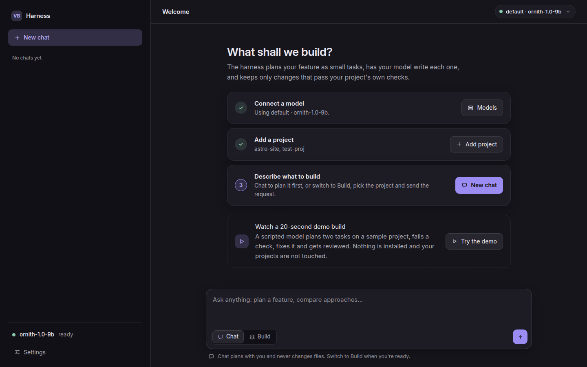

1. **Connect a model (Settings → Models).** The app looks for LM Studio and Ollama on this machine. You can start
   LM Studio's server, load a downloaded model, or pull an Ollama model, each with one click. For any other server,
   enter its OpenAI-compatible URL under **Another server** and, if it needs a key, the *name* of the environment
   variable that holds the key (never the key itself). Choose **Use** on a model: the harness probes it and shows
   what it found as plain labels, for example "48K context · JSON mode: yes · tools: yes · thinking can be turned
   off". **Plan & review** on any model makes it the model the planner, reviewer and verifier use, even on the same
   server as the first. **Settings → How runs work** picks the [mode](#configuration) (Careful, Balanced or Quick)
   and the way of working (Pipeline or Agent).

   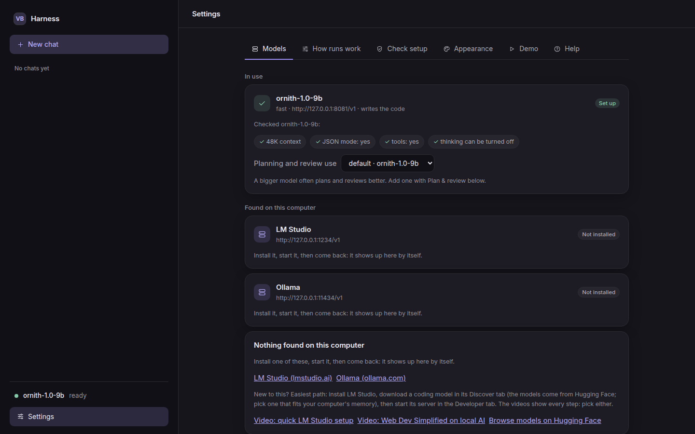
2. **Chat.** Chat mode is a planning conversation: work out what to build, compare approaches, sketch the steps.
   Ctrl+Enter (⌘+Enter on macOS) sends; Enter adds a line. Replies stream. When the model thinks first, you see
   **Thinking… 4s** with its latest line of thought as it works; afterwards it folds into **Thought for 12s** above
   the reply, and a click opens the whole thought process so you can judge how it got there. Chat changes no files. **Use as build request** under a reply copies it into the text box in
   Build mode, for you to edit and send: nothing starts until you do.

   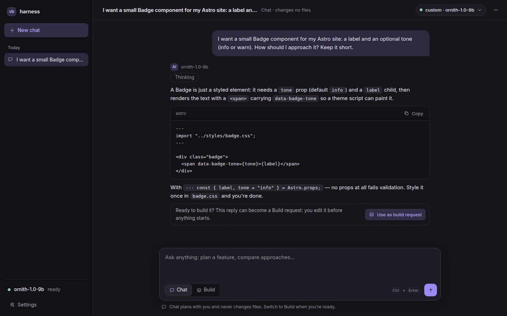
3. **Build.** Switch the text box to **Build**, pick a project (or **Add project**), describe the feature, and choose
   **Start build**. The line under the text box says what will happen; if something stops the build (uncommitted
   changes, a project with a problem), a card in the chat above the text box says what and offers its fixes. A live card in the chat shows the run:
   - a progress bar, **Plan → Tasks → Final checks → Review → Report**;
   - a **Now** line in plain words ("T1 Double the price: running your checks") with how long ago it last moved, so a
     model that is still writing a long answer is not mistaken for a hang;
   - every task with its state, its commit, and for the active one its steps (Read, Write, Apply, Check, Fix, Review,
     Commit);
   - how many model answers were kept and how many the harness's checks caught. **Why?** lists the reasons in plain
     words; catching bad output is the harness doing its job, and none of it reaches your code;
   - in agent mode, a box to send the agent a note, and **Stop after this task**.

   If the planner has blocking questions, the card turns amber and asks them in the card itself, one field per
   question, with **Answer and continue**. When the run ends, the card shows a short summary, the branch with
   **Copy branch**, and **View report**, which opens the report beside the chat. A stopped or failed run has
   **Resume**, which continues where it left off and keeps what was committed.

   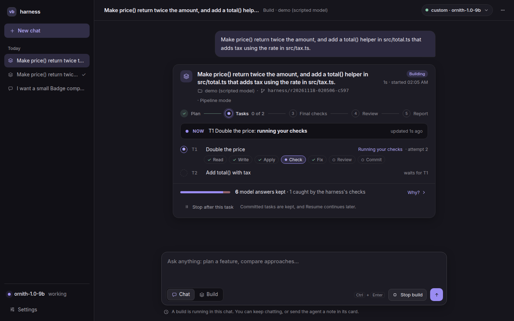

The app only listens on `127.0.0.1`, refuses other host names, and needs a per-start token for every change.

### Appearance

**Settings → Appearance** chooses the look: **System** (follows your computer's light or dark setting), **Dark** or
**Light**. Each look has a few colour presets, and you can pick your own colours for the background, cards, text,
accent and the three status colours. The app shows the text contrast as you go and warns when it gets hard to read.
Only colours change; the font and layout stay the same. The choice is saved in `appearance.json` next to
`config.json`.

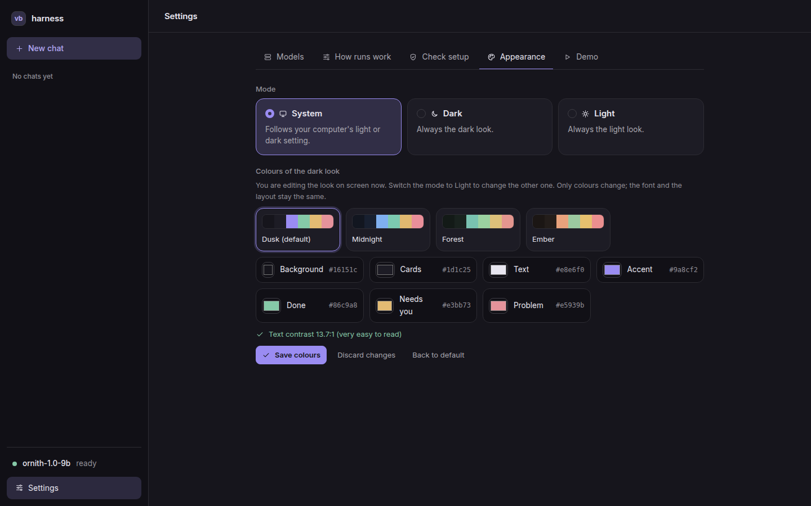

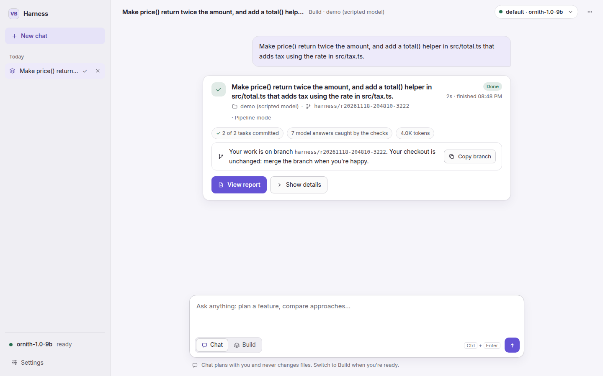

## Use it from your phone (LAN mode)

> **Off by default. Only on a network you trust.** LAN mode opens the app to other devices on your local network.
> Read the precautions below before you turn it on.

```bash
ruby exe/harness ui --lan                # your computer's private address, found for you
ruby exe/harness ui --lan 192.168.1.20   # or name it
```

The terminal prints an address such as `http://192.168.1.20:4567/` and a 6-digit code; the app on the computer shows
the same in a banner at the top. Open the address on your phone, type the code, and the phone gets the full app: chat,
start builds, answer the planner's questions, send the agent notes, stop and resume, read reports. The app is laid out
for phones.

What protects it:

- **Off unless you ask, every time.** Only `--lan` turns it on, for that run of the app. It is never saved.
- **Private addresses only.** It listens on a `10.x`, `172.16–31.x` or `192.168.x` address, never on every interface
  (`0.0.0.0`) and never on a public address. The app on `127.0.0.1` stays as it is.
- **Pairing.** A device sees nothing but the pairing page until it types the code. A code pairs one device, expires
  after 10 minutes, and five wrong tries lock pairing until you make a new code on the computer. A paired device holds
  a random session cookie that ends when the app stops or you choose **Stop sharing**.
- **The phone cannot change your machine.** From the LAN there is no way to run model-server commands (LM Studio,
  Ollama), add, clone or create projects, run setup fixes, start a Preview, or change settings, models or the look.
  Those stay on the computer.
- **Same checks as the computer.** Every change from the phone also needs the app's per-start token and its own
  origin; foreign host names are refused.

Precautions:

- **Use it only on a network you trust**, such as your home Wi-Fi. Never on public, hotel, café or office guest
  Wi-Fi.
- **Traffic is not encrypted** (plain HTTP). Anyone who can watch your network can read the pairing code, your
  messages, the code the model writes and the session cookie. That is why trusted networks only.
- **Never forward the port** on your router or expose it to the internet, and do not put it behind a public tunnel.
- **Allow it on private networks only** if your firewall asks (on Windows: Private, not Public).
- **Stop sharing when you are done**: the banner's **Stop sharing**, or Ctrl+C in the terminal.
- **A paired phone can start builds**, and builds run your project's own checks (its commands) on your computer.
  Pair only devices you own.

On Windows with WSL: WSL's own address (`172.x`) cannot be reached from a phone. Turn on WSL's mirrored networking
(then use your PC's address), or run the harness on Windows. The harness warns when this looks like the case.

## Quick start: the command line

```bash
ruby exe/harness demo                                   # a whole run on a sample project, no model needed
ruby exe/harness init                                   # write config.json, asking a few questions
ruby exe/harness doctor --repo /path/to/repo            # check everything a run needs, in one list
ruby exe/harness run --repo /path/to/repo --request request.md
ruby exe/harness status                                 # the newest run: tasks, current step, rejections
ruby exe/harness status RUN_ID --watch                  # refresh every second until it stops
ruby exe/harness answer RUN_ID                          # answer the planner's blocking questions
ruby exe/harness steer RUN_ID "a note"                  # steer a running agent-mode run, or answer its question
ruby exe/harness resume RUN_ID                          # continue after a stop, a crash or new answers
ruby exe/harness report RUN_ID                          # (re)write runs/RUN_ID/report.md and print its path
```

`request.md` is plain text, as you would write it to a colleague:

```markdown
Add a Badge component at src/components/Badge.astro. It takes a required label and an optional tone,
"info" or "warn" (default "info"), and renders <span class="badge badge--<tone>">. Use it on the pricing page.
```

Useful options:

| Option | Where | What it does |
| --- | --- | --- |
| `--config FILE` | every command | Use another config; runs and caches live next to it. |
| `--json` | every command | Machine-readable output. |
| `--plan-only` | `run` | Stop after planning; edit `runs/<id>/plan.json`, then `resume`. |
| `--dry-run` | `run` | Run intake, the baseline gates and, with `--from-plan`, the plan checks, then stop. No model is called and the worktree is removed. `"dryRun": true` in the config does the same for every `run`. |
| `--require-green-baseline` | `run` | Stop after intake when a blocking gate already fails (see `requireGreenBaseline`). |
| `--review MODE` | `run`, `answer`, `resume` | `full`, `light` or `off` for this run, overriding the config's `review`. |
| `--mode MODE` | `run`, `answer`, `resume` | `pipeline` or `agent` for this run, overriding the config's `mode` (see Agent mode). |
| `--from-plan FILE` | `run` | Skip the planner and run a plan you wrote (format below). With `--request` too, the request is kept as context for the implementer and reviewers. |
| `--answers FILE` | `answer` | A JSON array of answers instead of typing them. |
| `--accept-changes` | `answer`, `resume` | Continue a run although the harness version or its prompts changed since it started (see Troubleshooting). |
| `--port N`, `--[no-]open` | `ui` | The app's port, and whether to open the browser. |

A plan for `--from-plan` is the JSON the planner writes (`runs/<id>/plan.json`), and it is checked the same way:

```json
{
  "tasks": [
    {
      "id": "T1",
      "title": "Add the Badge component",
      "intent": "1-3 sentences: what and why, with every exact value the task needs",
      "files": { "create": ["src/components/Badge.astro"], "modify": [], "read": ["src/styles/global.css"] },
      "dependsOn": [],
      "acceptance": [
        { "kind": "gate", "gate": "typecheck" },
        { "kind": "test", "path": "tests/badge.test.ts", "write": true, "describe": "what the test asserts" },
        { "kind": "assert", "text": "a property the review checks" }
      ]
    }
  ],
  "questions": []
}
```

Each task creates or modifies at most `maxFilesPerTask` files and needs at least one `gate` or `test` item; a
`test` path must be a test file. `read` and `modify` list existing files or files a task in `dependsOn` creates.

Progress lines go to stderr; the result goes to stdout. Exit codes: `0` done, `1` the run failed (planning
failed, a task was blocked, or something regressed), `2` a configuration or environment problem, `3` waiting for
your answers.

## Projects and workspaces

In the app, Build mode works on **projects**. **Add project** (next to the project picker under the text box, or on
the start page) offers three ways:

- **Link an existing folder.** Paste its full path once. The harness checks it is the top folder of a git
  repository and shows its branch, whether it is clean, and the detected stack and version, or exactly what is
  wrong. Linked folders are stored by name in your `config.json`.
- **Clone from a git URL.** A shallow clone of an `https://` URL into `projects/<name>`.
- **New Astro project.** `npm create astro@latest` into `projects/<name>`, then a first commit.

Clone and New Astro project download code, so the dialog first shows you the exact command and runs it only after
you choose **Clone project** or **Create project**. The app never lists folders on your disk.

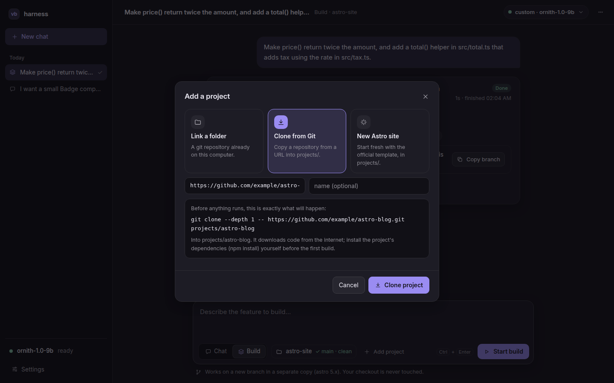

Every run works in its own worktree under `workspaces/<runId>` in the harness's home, on branch `harness/<runId>`.
Folders listed in the stack's `dependencyDirs` (for Astro, `node_modules`) are mirrored into the worktree with hard
links, so your project's tools can run there without reinstalling. The harness never writes to them, and every file it
writes replaces the link instead of writing through it.

To keep the result, merge the branch in your repository:

```bash
git merge harness/RUN_ID
```

## Understanding a run

Everything about a run is in `runs/<runId>/`:

| File | What it holds |
| --- | --- |
| `report.md` | The summary to read first. |
| `events.jsonl` | Every stage and every rejected output, with a reason code. `status` and the app are built from it. |
| `plan.json`, `run.json` | The plan as run, and the run's state, including the harness version, prompts and config it started with. |
| `tasks/<id>/` | Per task: `state.json`, gate results per round, `review.json`, and `blocked.patch` if it was blocked. |
| `records/` | One file per model request: role, profile, model id, tokens, time, outcome, and for a failed request the HTTP status and the server's error text (redacted). Never a key. |
| `final_review.json` | The review of the whole run. |

**Read this first**, at the top of the report when it applies, says what the numbers below do not show: a gate
that could not run, review that was off or light, a run that failed or stopped early, a dry run, and anything that
changed while the run was paused. Each line says what to do about it.

**Rejections** are the heart of the report: every output the harness threw away is counted by reason, such as
"edit search text not found", "typecheck failed", "depends on code not shown" or "needs a value its type forbids".
Replies that were discarded and retried with thinking off count too. Rejections show where a model struggles, and
they are how you compare models.

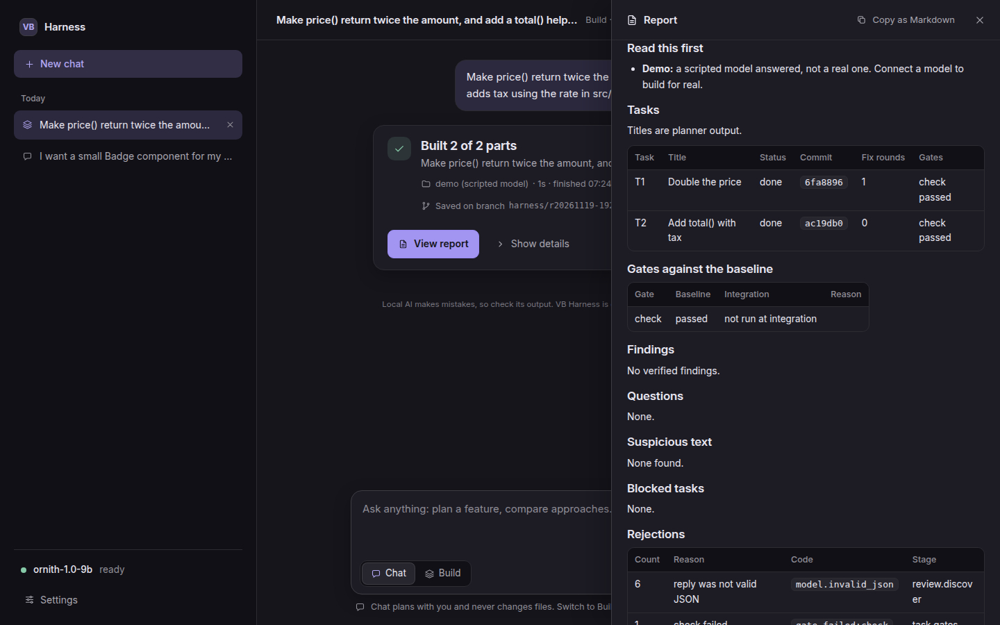

**Findings** in the report are only claims confirmed by a failing test. Everything else the review raised is under
**Questions**, clearly marked as unconfirmed.

## Cookbook: an Astro landing page

[docs/cookbook/astro-landing-page.md](docs/cookbook/astro-landing-page.md) builds a small business landing page
from an empty folder with a local 16K coder model: the new project, the theme, planning in Chat, the Build request
line by line, seven runs (the first two found harness gaps, now fixed; the last four were layout and fixes after
reviewing the page), reviewing the branch and merging it. Every stage has a screenshot.

[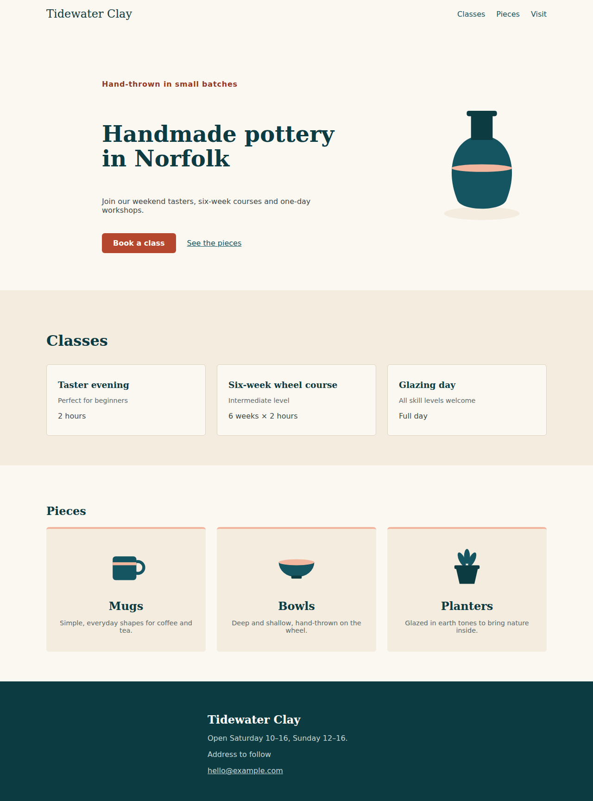](docs/cookbook/astro-landing-page.md)

## Using with Claude

Claude Code is good at deciding what to build and at reviewing it; the typing in between is where most of its
tokens go. The harness can take that part. Claude writes the request, starts a run, and reads back a short report
and a diff, while a model on your own machine does the planning, editing, fixing and reviewing in between.

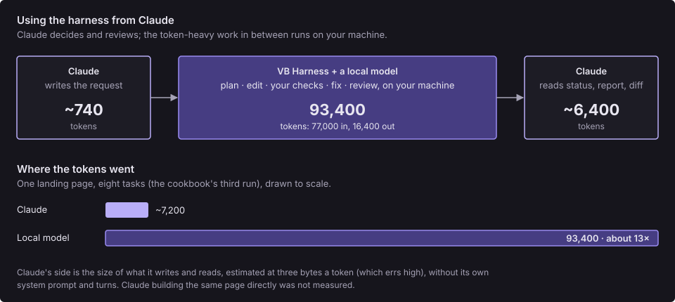

**What it saves, measured on the cookbook's third run** (eight tasks, a full landing page):

| | Tokens |
| --- | --- |
| The local model, all of its calls | 93,400 (77,000 in, 16,400 out) |
| Claude: writing the request | ~740 |
| Claude: reading `harness status --json` | ~2,000 |
| Claude: reading the report | ~1,300 |
| Claude: reading the diff (375 lines) | ~3,100 |
| **Claude, in all** | **~7,200** |

About 13 times the model traffic stayed on the local machine. Claude's figures are the sizes of what it would
read and write, estimated the way the harness budgets context (three bytes a token, which errs high); they leave out
Claude's own system prompt and turns. We
have not measured Claude building the same page directly, so this is not a claim about how much that would cost;
it would at least read the files, write the 375 lines and check them, with every turn re-sending the conversation.

The trade is time. A 16K local model one request at a time took a couple of hours for that page. Hand the harness
the work that is clear and self-contained, and keep Claude for the parts that need judgment.

**How to set it up.** Install the harness and connect a local model (see [Install](#install) and
[Choosing and checking a model](#choosing-and-checking-a-model)). Then tell Claude Code how to delegate, in your
project's `CLAUDE.md`:

```markdown
## Delegating to VB Harness

For a self-contained feature (a component, a page, a small refactor), delegate to the local harness instead of
writing the code yourself:

1. Write the request to `.harness/request.md`: exact file paths, exact values (colours, sizes, text), what each
   file imports, and what is out of scope. The harness keeps what the request says and nothing else.
2. Run it in the background: `ruby <harness>/exe/harness run --repo . --request .harness/request.md --json`.
3. Check on it with `ruby <harness>/exe/harness status RUN_ID --json` rather than polling often; runs take
   minutes to hours.
4. Exit code 3 means the planner asked questions: answer with `harness answer RUN_ID --answers answers.json`.
5. When it finishes, read `runs/RUN_ID/report.md` and `git diff main...harness/RUN_ID`. Gates prove the code
   builds, not that it matches the request, so review it. Merge with `git merge harness/RUN_ID`, or send a
   smaller follow-up request.
```

Any command works the same from Claude's side: `--json` on every command gives machine-readable output, progress
goes to stderr, and the exit code says how the run ended (see [Quick start: the command line](#quick-start-the-command-line)).

## Building from a Figma design

Paste a link to a Figma frame into your request, and the run builds from that design:

```text
Add a pricing section to the home page, matching https://www.figma.com/design/FILE/Name?node-id=1-2
```

1. In Figma, select the frame and use **Copy link**. A link to a whole file is refused, because it doesn't say what to
   build.
2. Create a Figma personal access token with read access to file content, and put it in the `FIGMA_TOKEN` env var. To
   use another variable, set `"figmaTokenEnv"` in `config.json`.

When the run starts, the harness reads each linked frame once and adds it to the run's `request.md` as a short outline:
structure, sizes, spacing, colours, type and wording. Pipeline and agent modes both use it, so the model needs no image
support and no Figma tools. A design that can't be read stops the run before any model is called, and the run shows the reason.

**Limits:** the outline is text, so images and icons appear only as named placeholders, and it stops at 5,000
characters, so link a section rather than a whole page. It's read once, so later changes in Figma don't reach a
running run.

**Safety:** only links in your request are read, so a model or a repo file can't choose what's fetched. Requests are
read-only. The token goes only into the request to Figma, and layer names and text reach models as untrusted data.

## Configuration

`harness init` (or the app's Settings) writes `config.json` for you. Start from
[`config.example.json`](config.example.json); every value there is a default or a placeholder.

**Profiles** describe model servers; **roles** say which profile does what:

```jsonc
"profiles": {
  "default": {
    "baseUrl": "http://127.0.0.1:8080/v1",
    "model": "auto",              // "auto" uses the first model the server lists
    "apiKeyEnv": null,            // the NAME of an env var holding a key, or null
    "contextTokens": "probe",     // or a number
    "maxOutputTokens": 4000,
    "thinking": { "control": "probe", "effort": "low", "budgetTokens": null },
    "structuredOutput": "probe",  // json_schema | json_object | prompt
    "toolCalls": "probe",         // native | none
    "continuation": "probe",      // prefill | continue_final_message | none
    "timeoutSec": 900
  }
},
"roles": { "planner": "default", "implementer": "default", "fixer": "default",
           "reviewer": "default", "verifier": "default", "summarizer": "default" }
```

Use two profiles to plan and review with a larger model and implement with a faster one. `HARNESS_<PROFILE>_BASE_URL`
and `HARNESS_<PROFILE>_MODEL` override a profile from the environment.

**Stacks** say how to check a project. The Astro stack in the example (each command runs as
`npx --offline --no -- <tool>`, so a tool that is not installed fails at once and npx never downloads one):

| Gate | Command | When | Blocking |
| --- | --- | --- | --- |
| `format` | `prettier --check {files}` | each task, touched files | no |
| `lint` | `eslint {files}` | each task, touched files | yes |
| `typecheck` | `astro check` | each task | yes |
| `unit` | `vitest run {tests}` | tasks with tests | yes |
| `build` | `astro build` | integration | yes |
| `e2e` | `playwright test {tests}` | integration | yes |

Gates are argv arrays, never shell strings. A gate whose tool is missing is reported as **skipped**, never as passed;
it blocks a task only when the task names it in its acceptance.
Gates may not install packages, run `git` or `gh`, or use `npx --yes`. Other stack keys: `detect` (files that
identify the stack), `alwaysGates`, `protectedPaths` (globs the model may never touch; `.git`, `.husky` and
`node_modules` are always protected), `dependencyDirs`, and `docs.local` (a local checkout of the framework's docs,
used by the review; without it, framework claims abstain instead of being confirmed).
Two keys power the app's buttons: `setup` maps a `dependencyDirs` folder to the command that creates it, offered as
a one-click **Fix** when it is missing (for example `"setup": {"generated": ["npx", "--offline", "--no", "--",
"prisma", "generate"]}`; `node_modules` needs no entry, its fix is the package manager's install with
`--ignore-scripts`), and `preview` is the dev server's argv with `{port}` where the port goes (the example config's
Astro stack has `["npx", "--offline", "--no", "--", "astro", "dev", "--host", "127.0.0.1", "--port", "{port}"]`).
Two keys carry what a small model gets wrong about the stack, as plain data: `fixHints` (`{"match": text in a
diagnostic, "hint": what to tell the fixer}`, shown next to a matching diagnostic) and `reviewNotes` (facts and
pitfalls the reviewer and verifier are given). The example's Astro stack has a few, such as "props are
`Astro.props`" and "`{expression}` output is escaped"; add your project's own.

**Limits** (defaults): `maxFilesPerTask` 3, `maxFixRounds` 3, `maxReplanRounds` 2, `maxDiagnostics` 20,
`maxLookups` 6, `maxReviewFixTasks` 2, `wholeFileRewriteMaxBytes` 4096, `maxGateOutputBytes` 204800,
`maxVerifierCalls` 60 (per run), `maxRefutedInARow` 3.

**Commits**: each task is committed as `<type>: <title>` in Conventional Commits form, with the type (`feat`, `fix`,
`chore`, `docs`, `test`, `refactor`, `style`, `perf`) chosen by the planner. A plan without a type falls back to
`T1: <title>`. The lines under the subject come from `"commit": {"trailer": "..."}`, default
`Gates passed: {gates}`. The placeholders are `{model}` (the implementer's model id), `{version}` (the harness
version), `{checks}` (how many gates passed) and `{gates}` (their names), for example
`"Commit by {model} from vb-harness {version}. {checks} checks passed"`.

**Review** (`review`, default `full`): `full` reviews every task and the whole run; `light` skips the per-task
review of a small change (80 changed lines or fewer) whose gates passed first time, and keeps the final review;
`off` skips review. In every mode the verifier stops when the run has used `maxVerifierCalls`, or after
`maxRefutedInARow` claims in a row were refuted by the code; the claims left are recorded as unverified
questions, never dropped. Review is the most expensive stage with a small model, so `light` is a good start.

**Modes.** `harness init` asks how careful runs should be, and the app's Settings can change it later; either
writes the matching settings, which you can still edit by hand:

| Mode | `review` | `requireGreenBaseline` | `maxFixRounds` | For |
| --- | --- | --- | --- | --- |
| Careful | `full` | `true` | 3 | Real projects, and weaker models. |
| Balanced (default) | `light` | `false` | 3 | Most work. |
| Quick | `off` | `false` | 2 | Trying things out, small changes. |

It also asks whether to use one model for everything, or a second model (often a larger one) for the planner,
reviewer and verifier, with the implementer and fixer on the first. That writes a `planning` profile and points
those `roles` at it. In the app, **Plan & review** on a model does the same, and Settings picks which configured
model those roles use. A config the app creates starts Balanced, like one from `init`.

**Agent mode** (`"mode": "agent"`, or `--mode agent`) trades speed for accuracy. Instead of one structured
reply per step, each task is worked by an agent with tools: it reads, lists and searches the code, edits files
(exact search-and-replace, whole files, and long new files in parts), and runs the project's gates and the
commands you allow, until it calls `finish`. Its finish is a claim, not a result: the harness then runs the task's
gates itself, and sends any failure back to the same agent, which keeps what it already read, until the gates
pass or `agent.maxRounds` runs out. Before planning, an investigating agent reads the repository (it cannot change
files) and its findings go to the planner, so plans and bug fixes start from the code as it is. Tasks may change
up to `agent.maxFilesPerTask` files.

The safety rules do not change. Writes stay in the worktree and outside `protectedPaths`; tool output is fenced as
untrusted; only gates mark a task done. The agent runs only the stack's gates and the commands you declare under
`agent.commands`, by name: an argument written exactly as `{name}` is filled from a declared parameter, either
`path` (an existing file in the repository) or `word` (letters, digits and `. _ : / @ -`, never starting with
`-`, and never an absolute path, drive letter or `..`). The model never writes a command line. Check configuration
(`package.json`, `tsconfig*.json`, `*.config.*`, linter configs and the like) and tests that already exist can be
changed only when the plan names them, so an agent cannot make a gate pass by weakening it.

| Key | Default | What it does |
| --- | --- | --- |
| `agent.maxSteps` | 60 | Tool calls per stretch of a task's work. |
| `agent.maxRounds` | 6 | How often the harness may send a task back after its gates failed. |
| `agent.maxFilesPerTask` | 12 | Files one task may change (replaces `maxFilesPerTask` in agent mode). |
| `agent.investigate` | `true` | Explore the repository before planning. |
| `agent.maxInvestigateSteps` | 30 | Tool calls for that exploration. |
| `agent.commands` | `{}` | Named commands the agent may run, as above. |
| `agent.askTimeoutSec` | 900 | How long an agent's question waits for your answer; 0 means it cannot ask. |
| `agent.maxRecoveries` | 3 | Further tries when an agent stops without finishing; 0 blocks the task at once. |
| `agent.acceptanceTests` | `false` | A separate agent writes each task's test from the request before the code exists. |

**Acceptance tests.** An implementer's own tests share its misunderstandings. With `agent.acceptanceTests` on, the
test a task's plan asks for is written first, from the request, by a separate agent on `roles.tester` (the reviewer's
model unless you set it). The implementer can read that test but not change it. Halfway through `agent.maxRounds`, a
test the code still fails gets one look from its author, who may correct it only against the request. Work that
passes such a test counts as done even if the agent never called `finish`. A task with no test in its plan, or a stack
with no test gate, works as before.

**When an agent stops early.** An agent that runs out of steps, or stops without calling `finish`, gets a limited
number of further tries, and each one changes something. First a new conversation, told by the harness what is
already in the repository. Then a smaller job: the harness runs the checks and gives the agent only what is left,
with half the steps. Then, if `roles.rescuer` names a different profile from `roles.implementer`, that model
takes over. After that the task blocks, and the report says what was tried.

**Steering a running agent.** While an agent-mode run works, `harness steer RUN_ID "use the existing Button
component"` (or the note box on its card in the app) sends it a note, which the agent reads before its next step,
as your words. An agent can also ask you a question with `ask_user` when the task is ambiguous: the question shows
on the card, in the events and in `run.json`, and your next note is the answer. If none comes within
`agent.askTimeoutSec`, the agent decides for itself and says in its summary what it assumed. In the app, Settings
switches the way of working between Pipeline and Agent, and an agent-mode card's **Agent activity** lists each agent's steps.

Agent mode makes many more model calls than the pipeline; with a local model, expect a task to take several
times longer. Models without native tool calls use a JSON reply protocol, one tool per reply.

**A red baseline.** When a blocking gate already fails before the run, intake says so (an event, and a line at the
top of the report); tasks are still judged only on new problems. Set `requireGreenBaseline` to `true` to stop the
run there instead, before any model call (exit code 2).

**A dry run** (`harness run --dry-run`, or `"dryRun": true` for every `run` on the command line) shows what a run
would start from without calling a model: the stack, each gate's baseline result, the plan's problems when a plan
is given (all but the context-size check, which needs the model), and what would happen next. It exits 0 when
nothing found would stop a real run, 1 for plan problems, 2 for a failing baseline under `requireGreenBaseline`.
The app's Build is never a dry run.

`gateEnvAllow` lists extra environment variables your gates need; everything that looks like a secret is removed
from the gates' environment otherwise.

## Choosing and checking a model

Nothing about specific models is built in. On first use, the harness probes each model: its context size, whether
it can return JSON or call tools, whether its thinking can be turned off, whether it can continue a reply it
started, and how fast it is. Values you set in a profile override the probe. Results are cached in `.cache/probe/`.

Practical advice:

- A coding model with 16K context or more, instruction-tuned, at a quantization that still follows JSON reliably.
- A reply cut off at `maxOutputTokens` is not thrown away. When the server can continue a reply, the harness asks
  the model to go on from where it stopped, up to three times, and checks the joined answer as usual. When a reasoning
  model spends its whole budget thinking, the harness retries once with thinking off and gives the model its reasoning
  so far, so the thinking is not lost. Set `continuation` to `none` to turn continuing off.
- Compare models with the [evaluation](#evaluation): the same ten tasks, one table per profile mapping.

## Safety model


The harness assumes the model can be wrong or manipulated, and limits what it can do:

- **Edits stay in the worktree.** Every path is resolved and checked before a read or write: no `..`, no absolute
  paths, no symlinks out, no protected paths, no Windows aliases such as `.git.` or `GIT~1`.
- **No commands from the model.** Only your configured gates and a fixed list of git subcommands run, as argv arrays.
  Git hooks are disabled for every git command the harness runs.
- **No remote writes.** Nothing is pushed, fetched or merged. The only download is a clone you confirm in the app.
- **Scrubbed environment.** Gates run without your tokens and secrets unless you list them in `gateEnvAllow`.
- **Tools decide.** A task is done only when its blocking gates pass or fail exactly as they did at baseline.
- **Untrusted text is fenced.** Repository content, docs, gate output and model output reach a model only inside a
  fenced block marked as data, never as instructions. Instruction-like text in your files ("ignore previous
  instructions", "note to the AI", ...) is also pointed out to the model as data and listed in the report. That
  detection is a pattern match: it catches common phrasings, not every reworded attempt, so it warns and never
  blocks. The fence, the fixed edit format and your gates are what keep a planted instruction from taking effect.
- **Findings need proof.** A review claim is presented as fact only when a test confirmed it.
- **No installs without you.** A run never installs anything. The app's **Fix** buttons can install a project's
  dependencies or a package its checks ask for, but only after showing you the exact command and only when you
  confirm; installs use `--ignore-scripts`, and commands come from the harness and your config, never from a model.
- **Your checkout is untouched.** All work happens on a branch in a separate worktree.
- **Keys.** Read only from the environment variable you name; never logged, recorded or shown.
- **The app is local.** It binds to `127.0.0.1`, refuses foreign hosts, needs a per-start token and its own origin
  for every change, sends a strict Content Security Policy, and renders model output as text, never HTML. LAN mode
  (`--lan`, off by default and never saved) adds your computer's private network address only, behind a pairing
  code, and a phone there can never run model-server commands, add projects or change settings.

Each of these has a test in [`test/guardrails_test.rb`](test/guardrails_test.rb). See [SECURITY.md](SECURITY.md)
to report a vulnerability.

## Evaluation

`eval/` holds ten Astro tasks of increasing size (a component, a utility, pages, a content collection, API routes,
an island, i18n routes, a blog) with hidden acceptance tests the harness never sees while it works.

```bash
ruby eval/run_eval.rb --config config.json --profile-map eval/profile-map.example.json
```

It prints one table per profile mapping: solved, solved without fix rounds, regressions, findings confirmed, fix
rounds, tokens and time, plus tokens and time per role. Preparing the starting repository is described in
[`eval/README.md`](eval/README.md).

## Troubleshooting

| Symptom | What to do |
| --- | --- |
| Not sure what is wrong | `harness doctor --repo PATH` checks Ruby, git, the config, each model server and the repository in one pass, and says what to do for each problem. |
| "the repository has uncommitted changes" | Commit or stash first. Runs always start from a clean `HEAD`. |
| "node_modules is missing … the project's dependencies are not installed" | In the app, choose the fix in the card above the text box (it shows the install command first). On the command line, run the install command it names (`npm install`, `pnpm install`, …) in your repository, then start the run again. A run never installs anything itself. |
| "typecheck cannot run yet: the project needs … installed" | The check's own tool asked for packages (Astro's checker needs `@astrojs/check` and `typescript`). Choose **Fix** on the build card, then **Build again**. |
| "Your project's own checks already fail before any change" | Careful mode stops on a red baseline. The card lists each failing check and its first problem: fix those in the project, or choose **Build anyway (Balanced)**, which judges tasks only on new problems. A project with no tests yet does not count as failing. |
| A gate is **skipped**: "the tool has no configuration in this project" | The tool is installed but its config file is missing (for example ESLint 9+ without `eslint.config.js`). Add the config to your project, or remove the gate from `alwaysGates`. Intake finds this before planning, so tasks are not blocked by it. |
| A gate is **skipped**: "tool not installed" | Install the project's dependencies in your repository (`npm install`), and keep `node_modules` in `dependencyDirs`. |
| "model server unavailable" | Check the server is running and `baseUrl` ends in `/v1`. `curl <baseUrl>/models` should list a model. |
| Tasks blocked with "plan too large for context" | Use a model with a larger context, or ask for a smaller change. |
| Many "edit search text not found" | The model is not copying code exactly. A larger or less quantized model usually helps. |
| The planner keeps asking | Answer with `harness answer RUN_ID` (or in the app); the run continues. |
| A run stopped (crash, Ctrl+C, power) | `harness resume RUN_ID` continues from the last saved step. |
| "… changed since this run started" | The harness was updated, or its prompt files edited, after the run began; `run.json` records both. Start a new run, or pass `--accept-changes` to `answer` or `resume` to continue anyway. A changed `config.json` only adds a note to the run's events. |
| Windows: paths too long | Keep the harness folder short (for example `C:\harness`); worktrees live under it. |
| The model server stays busy after a run | A request the harness gave up on (a timeout, a stop, a crash) is closed on the harness's side; a server that does not notice a closed connection keeps generating until it finishes. Wait, or restart the server. Raise `timeoutSec` if requests time out often. |

## Limitations

- AstroJS is the only stack with a ready-made profile. Others work with your own gates, but without the Astro-aware
  context map and docs.
- Review evidence uses a local docs checkout only; online docs are not fetched.
- Gates run your tools on your machine: a gate is as trustworthy as the command you configure.
- `harness cleanup` and `push` are not implemented yet; use `git` directly to push a branch.

## Why Ruby

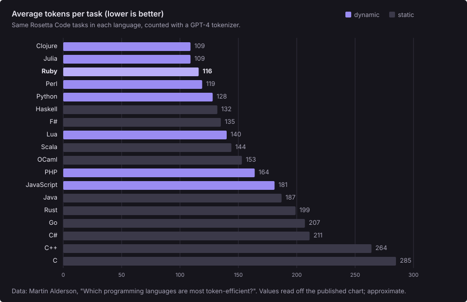

*Chart redrawn from the data in Martin Alderson's
[Which programming languages are most token-efficient?](https://martinalderson.com/posts/which-programming-languages-are-most-token-efficient/)
(values read off the published chart). The study counted tokens for the same Rosetta Code tasks in each language
using a GPT-4 tokenizer. Its author calls it an illustrative comparison, not a rigorous study. TypeScript was left
out for lack of tasks.*

- **Fewer tokens.** Ruby is one of the most token-efficient mainstream languages. In the chart above it needs about
  a third fewer tokens than JavaScript for the same task. A harness built for small context windows benefits twice:
  models read and write less code, and contributors' agents spend less context on the harness itself.
- **Contributing with local models.** Fewer tokens and zero dependencies mean a local model on modest hardware can
  read, change and test this codebase. Contributing doesn't require a large hosted model.
- **Easy to read.** Human contributors can catch up quickly without much effort. TypeScript and its types would have
  been the stronger choice for people alone. This is an agent-first harness, though, so it is written in a language
  that is friendlier to agents and still easy for people.
- **Easy to review.** Ruby is easy to skim when you approve a pull request, read code or leave review comments. That
  matters for a project that expects many outside contributions.

## Development

```bash
ruby bin/check   # syntax and warnings, guardrail scans, all tests
ruby bin/test    # tests only (or: ruby bin/test test/path_test.rb)
```

Tests need no model server, network or GPU. There is no hosted CI: run `bin/check` before opening a pull request
and paste its summary, as described in [CONTRIBUTING.md](CONTRIBUTING.md). Design decisions are recorded in
[docs/decisions.md](docs/decisions.md); a manual checklist for the app is in [docs/ui-checklist.md](docs/ui-checklist.md).

## License

Apache-2.0, by [V and Bruno LLC](https://vandbruno.net/). See [LICENSE](LICENSE) and [NOTICE](NOTICE). The bundled
Inter font is under the SIL Open Font License ([OFL.txt](lib/harness/ui/public/fonts/OFL.txt)).

## Disclaimer

All local AI models are prone to mistakes: always check their output before you use it. VB Harness is for
experimentation only. It is provided as is, with no warranty or guarantee of any kind (see the
[Apache-2.0 license](LICENSE)); you run it at your own risk, and using it means you accept that.
