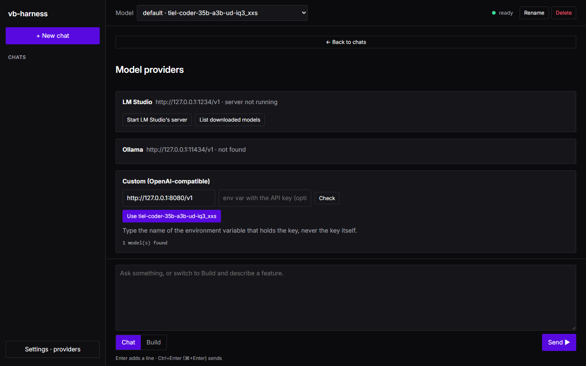
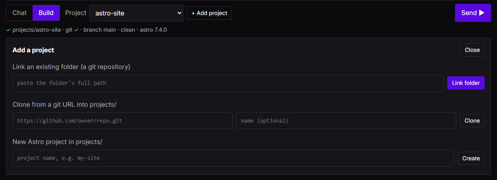
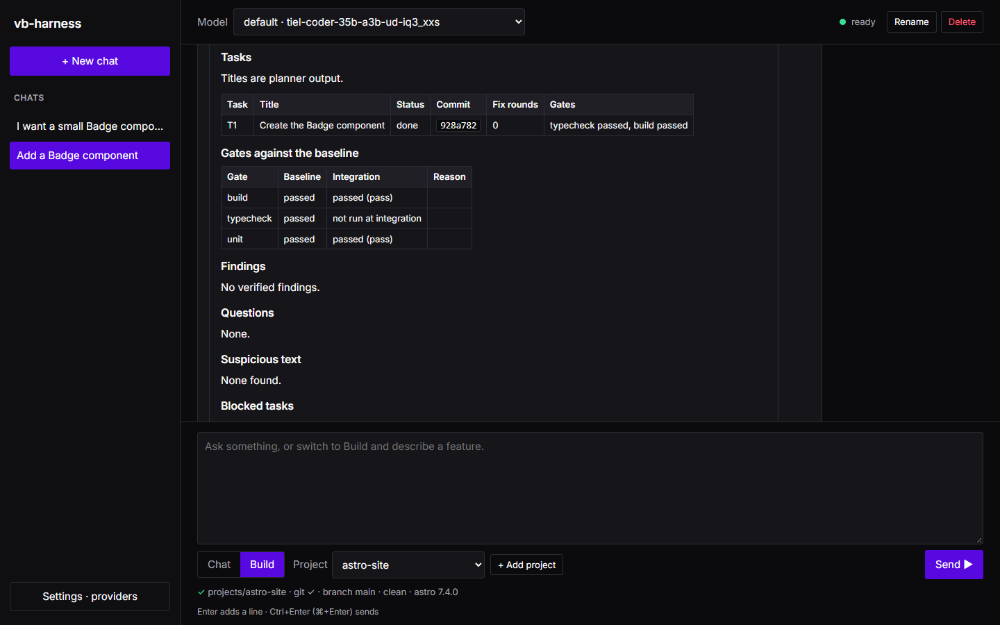
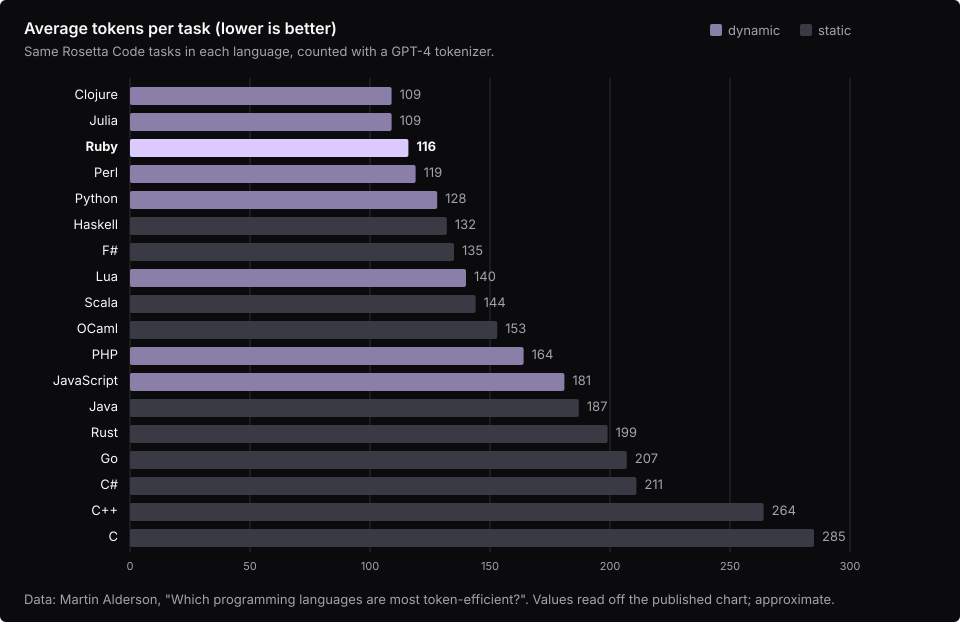

# vb-harness-for-agentic-building

Get real coding work out of the model on your own machine. The harness plans a feature as small tasks, has your
local model implement them one at a time, proves every change with your project's own type check, lint, build and
tests, and re-reviews what it built with an evidence gate. It is built around the weak spots of local models:
hallucinated APIs and defects, wrong edits, broken JSON, and small context windows.

[](docs/media/demo.mp4)

*An animated illustration of a run in the app, ending with the component it built, rendered (not a screen recording). Click it for the 1080p, 60 fps video.*

AstroJS is the first supported stack. Any OpenAI-compatible endpoint works: LM Studio, Ollama, llama.cpp's server,
vLLM, or a hosted API.

**Status: early development.** Everything below works and is tested, but expect rough edges and changes.

## Contents

- [How it works](#how-it-works)
- [Requirements](#requirements)
- [Install](#install)
- [Quick start: the app](#quick-start-the-app)
- [Quick start: the command line](#quick-start-the-command-line)
- [Projects and workspaces](#projects-and-workspaces)
- [Understanding a run](#understanding-a-run)
- [Configuration](#configuration)
- [Choosing and checking a model](#choosing-and-checking-a-model)
- [Safety model](#safety-model)
- [Evaluation](#evaluation)
- [Troubleshooting](#troubleshooting)
- [Limitations](#limitations)
- [Why Ruby](#why-ruby)
- [Development](#development)
- [License](#license)

## How it works


1. **Intake.** The harness checks your repository is clean, creates a git worktree on a new branch
   `harness/<runId>`, detects the stack, and runs your checks once to record a **baseline**. Anything already
   failing there is compared later, not blamed on the model.
2. **Plan.** A planner model splits the request into small tasks (at most 3 files each, by default), each with
   something that can prove it: a gate (type check, lint, tests) or a test it writes. Plans are checked in code:
   missing files, cycles, tasks that change nothing, tasks too big for the model's context. Problems go back to the
   planner. Questions that block the plan are asked to you.
3. **Each task.** The context is packed to fit the model's window: the task's files first, then signatures and
   summaries of the files they import. The model replies with exact search-and-replace edits; edits that do not
   match the file exactly are rejected with the closest lines, and the model gets one retry.
4. **Gates.** Your own commands decide whether a task is done. New errors go back to the model with the source
   around them, for a few fix rounds. A model saying "done" never marks a task done.
5. **Review.** Two independent review passes propose claims; a verifier checks each against the code it can fetch
   (and, for Astro, version-matched docs); a gate in code rejects or abstains on anything not backed by evidence;
   a challenge argues for the code. A surviving claim becomes a **finding** only if a test the harness writes and
   runs fails because of it, and then it becomes a fix task. Review never blocks a commit on its own.
6. **Report.** Every run ends with `runs/<runId>/report.md`: tasks and commits, gates against the baseline, findings,
   open questions, blocked tasks with their patch, every rejected model output counted by reason, and cost per role.

Your checkout is never changed. The work stays on the `harness/<runId>` branch until you merge it.

## Requirements

- **Ruby 3.3 or newer.** No gems. On Windows, use [RubyInstaller](https://rubyinstaller.org/) (with the Devkit).
- **git.**
- **A model server** with an OpenAI-compatible API, such as `http://127.0.0.1:8080/v1`. A model with at least a
  16K context works; more is better.
- **Your project's own toolchain.** For Astro that is Node.js, with the project's dependencies installed
  (`npm install`) in the repository you build in.

## Install

```bash
git clone https://github.com/Viktotovich/vb-harness-for-agentic-building.git
cd vb-harness-for-agentic-building
ruby exe/harness --version
```

That is all: there is nothing to install with `gem` or `bundle`. To put `harness` on your PATH, either alias
`ruby /path/to/vb-harness-for-agentic-building/exe/harness`, or build and install the gem locally:

```bash
gem build vb-harness.gemspec
gem install ./vb-harness-*.gem
```

The folder that holds `config.json` is the harness's **home**: `chats/`, `runs/`, `logs/`, `.cache/`, `projects/`
and `workspaces/` are created next to it. All of them are git-ignored.

## Quick start: the app

```bash
ruby exe/harness
```

This starts the local app on `http://127.0.0.1:4567/` and, on first start, opens your browser.

1. **Connect a model (Settings · providers).** The app looks for LM Studio and Ollama on this machine. You can
   start LM Studio's server, load a downloaded model, or pull an Ollama model, each with one click. For any other
   server, enter its OpenAI-compatible URL and, if it needs a key, the *name* of the environment variable that holds
   the key (never the key itself). Choose **Use** on a model: the harness probes it and tells you what it found, for
   example "16K context, JSON mode: yes, tools: no, thinking can be turned off".

   
2. **Chat.** Chat mode is a planning conversation: work out what to build, compare approaches, sketch the steps.
   Ctrl+Enter (⌘+Enter on macOS) sends; Enter adds a line. Replies stream, and thinking text sits in a collapsed
   block. Chat changes no files.

   
3. **Build.** Switch to Build, pick a project (or **+ Add project**), describe the feature, and send. A live card
   shows where the run is, how many model outputs were thrown away and why. If the planner asks a blocking
   question, the card turns purple: answer in the text box, one answer per line. When the run ends, **Show report**
   opens the report.

   

The app only listens on `127.0.0.1`, refuses other host names, and needs a per-start token for every change.

## Quick start: the command line

```bash
ruby exe/harness init                                   # write config.json, asking a few questions
ruby exe/harness run --repo /path/to/repo --request request.md
ruby exe/harness status                                 # the newest run: tasks, current step, rejections
ruby exe/harness status RUN_ID --watch                  # refresh every second until it stops
ruby exe/harness answer RUN_ID                          # answer the planner's blocking questions
ruby exe/harness resume RUN_ID                          # continue after a stop, a crash or new answers
ruby exe/harness report RUN_ID                          # (re)write runs/RUN_ID/report.md and print its path
```

`request.md` is plain text, as you would write it to a colleague:

```markdown
Add a Badge component at src/components/Badge.astro. It takes a required label and an optional tone,
"info" or "warn" (default "info"), and renders <span class="badge badge--<tone>">. Use it on the pricing page.
```

Useful options:

| Option | Where | What it does |
| --- | --- | --- |
| `--config FILE` | every command | Use another config; runs and caches live next to it. |
| `--json` | every command | Machine-readable output. |
| `--plan-only` | `run` | Stop after planning; edit `runs/<id>/plan.json`, then `resume`. |
| `--from-plan FILE` | `run` | Skip the planner and run a plan you wrote. |
| `--answers FILE` | `answer` | A JSON array of answers instead of typing them. |
| `--port N`, `--[no-]open` | `ui` | The app's port, and whether to open the browser. |

Progress lines go to stderr; the result goes to stdout. Exit codes: `0` done, `1` a task was blocked or something
regressed, `2` a configuration or environment problem, `3` waiting for your answers.

## Projects and workspaces

In the app, Build mode works on **projects**:

- **Link an existing folder.** Paste its full path once. The harness checks it is the top folder of a git
  repository and shows its branch, whether it is clean, and the detected stack and version, or exactly what is
  wrong. Linked folders are stored by name in your `config.json`.
- **Clone from a git URL.** A shallow clone of an `https://` URL into `projects/<name>`.
- **New Astro project.** `npm create astro@latest` into `projects/<name>`, then a first commit.

Clone and New Astro project download code, so the app first shows you the exact command and runs it only after you
confirm. The app never lists folders on your disk.



Every run works in its own worktree under `workspaces/<runId>` in the harness's home, on branch `harness/<runId>`.
Folders listed in the stack's `dependencyDirs` (for Astro, `node_modules`) are mirrored into the worktree with hard
links, so your project's tools can run there without reinstalling. The harness never writes to them, and every file it
writes replaces the link instead of writing through it.

To keep the result, merge the branch in your repository:

```bash
git merge harness/RUN_ID
```

## Understanding a run

Everything about a run is in `runs/<runId>/`:

| File | What it holds |
| --- | --- |
| `report.md` | The summary to read first. |
| `events.jsonl` | Every stage and every rejected output, with a reason code. `status` and the app are built from it. |
| `plan.json`, `run.json` | The plan as run, and the run's state. |
| `tasks/<id>/` | Per task: `state.json`, gate results per round, `review.json`, and `blocked.patch` if it was blocked. |
| `records/` | One file per model request: role, profile, model id, tokens, time, outcome, and for a failed request the HTTP status and the server's error text (redacted). Never a key. |
| `final_review.json` | The review of the whole run. |

**Rejections** are the heart of the report: every output the harness threw away is counted by reason, such as
"edit search text not found", "typecheck failed", "depends on code not shown" or "needs a value its type forbids".
Replies that were discarded and retried with thinking off count too. Rejections show where a model struggles, and
they are how you compare models.



**Findings** in the report are only claims confirmed by a failing test. Everything else the review raised is under
**Questions**, clearly marked as unconfirmed.

## Configuration

`harness init` (or the app's Settings) writes `config.json` for you. Start from
[`config.example.json`](config.example.json); every value there is a default or a placeholder.

**Profiles** describe model servers; **roles** say which profile does what:

```jsonc
"profiles": {
  "default": {
    "baseUrl": "http://127.0.0.1:8080/v1",
    "model": "auto",              // "auto" uses the first model the server lists
    "apiKeyEnv": null,            // the NAME of an env var holding a key, or null
    "contextTokens": "probe",     // or a number
    "maxOutputTokens": 4000,
    "thinking": { "control": "probe", "effort": "low", "budgetTokens": null },
    "structuredOutput": "probe",  // json_schema | json_object | prompt
    "toolCalls": "probe",         // native | none
    "timeoutSec": 900
  }
},
"roles": { "planner": "default", "implementer": "default", "fixer": "default",
           "reviewer": "default", "verifier": "default", "summarizer": "default" }
```

Use two profiles to plan and review with a larger model and implement with a faster one. `HARNESS_<PROFILE>_BASE_URL`
and `HARNESS_<PROFILE>_MODEL` override a profile from the environment.

**Stacks** say how to check a project. The Astro stack in the example:

| Gate | Command | When | Blocking |
| --- | --- | --- | --- |
| `format` | `npx prettier --check {files}` | each task, touched files | no |
| `lint` | `npx eslint {files}` | each task, touched files | yes |
| `typecheck` | `npx astro check` | each task | yes |
| `unit` | `npx vitest run {tests}` | tasks with tests | yes |
| `build` | `npx astro build` | integration | yes |
| `e2e` | `npx playwright test {tests}` | integration | yes |

Gates are argv arrays, never shell strings. A gate whose tool is missing is reported as **skipped**, never as passed.
Gates may not install packages, run `git` or `gh`, or use `npx --yes`. Other stack keys: `detect` (files that
identify the stack), `alwaysGates`, `protectedPaths` (globs the model may never touch; `.git`, `.husky` and
`node_modules` are always protected), `dependencyDirs`, and `docs.local` (a local checkout of the framework's docs,
used by the review; without it, framework claims abstain instead of being confirmed).

**Limits** (defaults): `maxFilesPerTask` 3, `maxFixRounds` 3, `maxReplanRounds` 2, `maxDiagnostics` 20,
`maxLookups` 6, `maxReviewFixTasks` 2, `wholeFileRewriteMaxBytes` 4096, `maxGateOutputBytes` 204800.

`gateEnvAllow` lists extra environment variables your gates need; everything that looks like a secret is removed
from the gates' environment otherwise.

## Choosing and checking a model

Nothing about specific models is built in. On first use, the harness probes each model: its context size, whether
it can return JSON or call tools, whether its thinking can be turned off, and how fast it is. Values you set in a
profile override the probe. Results are cached in `.cache/probe/`.

Practical advice:

- A coding model with 16K context or more, instruction-tuned, at a quantization that still follows JSON reliably.
- If a reasoning model spends its whole budget thinking, the harness retries once with thinking off. Setting
  `thinking.control` explicitly avoids the retry.
- Compare models with the [evaluation](#evaluation): the same ten tasks, one table per profile mapping.

## Safety model


The harness assumes the model can be wrong or manipulated, and limits what it can do:

- **Edits stay in the worktree.** Every path is resolved and checked before a read or write: no `..`, no absolute
  paths, no symlinks out, no protected paths, no Windows aliases such as `.git.` or `GIT~1`.
- **No commands from the model.** Only your configured gates and a fixed list of git subcommands run, as argv arrays.
  Git hooks are disabled for every git command the harness runs.
- **No remote writes.** Nothing is pushed, fetched or merged. The only download is a clone you confirm in the app.
- **Scrubbed environment.** Gates run without your tokens and secrets unless you list them in `gateEnvAllow`.
- **Tools decide.** A task is done only when its blocking gates pass or fail exactly as they did at baseline.
- **Untrusted text is fenced.** Repository content, docs, gate output and model output reach a model only inside a
  fenced block marked as data, never as instructions. Instruction-like text in your files ("ignore previous
  instructions", "note to the AI", ...) is also pointed out to the model as data and listed in the report. That
  detection is a pattern match: it catches common phrasings, not every reworded attempt, so it warns and never
  blocks. The fence, the fixed edit format and your gates are what keep a planted instruction from taking effect.
- **Findings need proof.** A review claim is presented as fact only when a test confirmed it.
- **No installs.** The harness never installs your project's dependencies; you do.
- **Your checkout is untouched.** All work happens on a branch in a separate worktree.
- **Keys.** Read only from the environment variable you name; never logged, recorded or shown.
- **The app is local.** It binds to `127.0.0.1` only, refuses foreign hosts, needs a per-start token and its own
  origin for every change, sends a strict Content Security Policy, and renders model output as text, never HTML.

Each of these has a test in [`test/guardrails_test.rb`](test/guardrails_test.rb). See [SECURITY.md](SECURITY.md)
to report a vulnerability.

## Evaluation

`eval/` holds ten Astro tasks of increasing size (a component, a utility, pages, a content collection, API routes,
an island, i18n routes, a blog) with hidden acceptance tests the harness never sees while it works.

```bash
ruby eval/run_eval.rb --config config.json --profile-map eval/profile-map.example.json
```

It prints one table per profile mapping: solved, solved without fix rounds, regressions, findings confirmed, fix
rounds, tokens and time, plus tokens and time per role. Preparing the starting repository is described in
[`eval/README.md`](eval/README.md).

## Troubleshooting

| Symptom | What to do |
| --- | --- |
| "the repository has uncommitted changes" | Commit or stash first. Runs always start from a clean `HEAD`. |
| A gate is **skipped**: "tool not installed" | Install the project's dependencies in your repository (`npm install`), and keep `node_modules` in `dependencyDirs`. |
| "model server unavailable" | Check the server is running and `baseUrl` ends in `/v1`. `curl <baseUrl>/models` should list a model. |
| Tasks blocked with "plan too large for context" | Use a model with a larger context, or ask for a smaller change. |
| Many "edit search text not found" | The model is not copying code exactly. A larger or less quantized model usually helps. |
| The planner keeps asking | Answer with `harness answer RUN_ID` (or in the app); the run continues. |
| A run stopped (crash, Ctrl+C, power) | `harness resume RUN_ID` continues from the last saved step. |
| Windows: paths too long | Keep the harness folder short (for example `C:\harness`); worktrees live under it. |

## Limitations

- AstroJS is the only stack with a ready-made profile. Others work with your own gates, but without the Astro-aware
  context map and docs.
- Review evidence uses a local docs checkout only; online docs are not fetched.
- Gates run your tools on your machine: a gate is as trustworthy as the command you configure.
- `harness probe`, `cleanup` and `push` are not implemented yet; use `git` directly to push a branch.

## Why Ruby



*Chart redrawn from the data in Martin Alderson's
[Which programming languages are most token-efficient?](https://martinalderson.com/posts/which-programming-languages-are-most-token-efficient/)
(values read off the published chart). The study counted tokens for the same Rosetta Code tasks in each language
using a GPT-4 tokenizer. Its author calls it an illustrative comparison, not a rigorous study. TypeScript was left
out for lack of tasks.*

- **Fewer tokens.** Ruby is one of the most token-efficient mainstream languages. In the chart above it needs about
  a third fewer tokens than JavaScript for the same task. A harness built for small context windows benefits twice:
  models read and write less code, and contributors' agents spend less context on the harness itself.
- **Contributing with local models.** Fewer tokens and zero dependencies mean a local model on modest hardware can
  read, change and test this codebase. Contributing doesn't require a large hosted model.
- **Easy to read.** Human contributors can catch up quickly without much effort. TypeScript and its types would have
  been the stronger choice for people alone. This is an agent-first harness, though, so it is written in a language
  that is friendlier to agents and still easy for people.
- **Easy to review.** Ruby is easy to skim when you approve a pull request, read code or leave review comments. That
  matters for a project that expects many outside contributions.
- **A bit of history.** Ruby and Ruby on Rails are what first pulled the author towards AdonisJS and deeper
  TypeScript work. There was never time to learn Ruby properly back then, but its influence stuck. This project is
  the chance to build in it.

## Development

```bash
ruby bin/check   # syntax and warnings, guardrail scans, all tests
ruby bin/test    # tests only (or: ruby bin/test test/path_test.rb)
```

Tests need no model server, network or GPU. There is no hosted CI: run `bin/check` before opening a pull request
and paste its summary, as described in [CONTRIBUTING.md](CONTRIBUTING.md). Design decisions are recorded in
[docs/decisions.md](docs/decisions.md); a manual checklist for the app is in [docs/ui-checklist.md](docs/ui-checklist.md).

## License

Apache-2.0, by [V and Bruno LLC](https://vandbruno.net/). See [LICENSE](LICENSE) and [NOTICE](NOTICE). The bundled
Inter font is under the SIL Open Font License ([OFL.txt](lib/harness/ui/public/fonts/OFL.txt)).
