<!-- SPDX-License-Identifier: Apache-2.0 -->
<!-- Copyright 2026 V and Bruno LLC -->

# Cookbook: an Astro landing page with a local model

This recipe builds a landing page for **Tidewater Clay**, a made-up pottery studio, from an empty folder to a
merged branch. A 9B local model with a 48K context window, running on one machine, wrote all of the code. The
recipe covers what was typed, what the model said, what went wrong and why each decision was made. It took seven
build runs:

- **Runs 1 and 2** built the content. Each failed on one task for the same reason, a gap in how the harness
  treats a task that finds its work already done.
- **Runs 3 and 4** laid the page out.
- **Runs 5 to 7** made it look finished, with drawings instead of empty tiles.

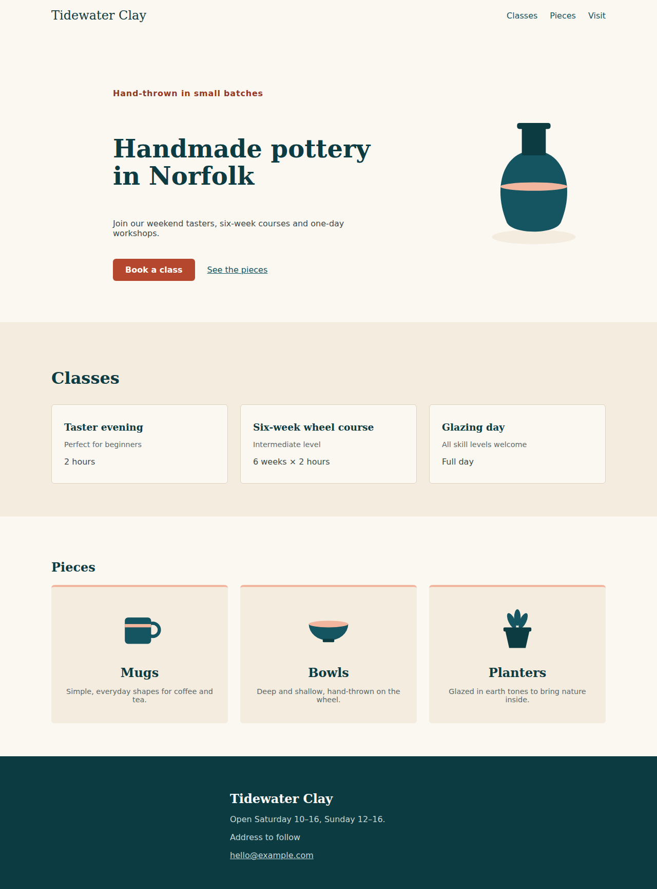

**Contents**

1. [What you need](#1-what-you-need)
2. [A new Astro project](#2-a-new-astro-project)
3. [Give the harness a type checker](#3-give-the-harness-a-type-checker)
4. [Choose the theme](#4-choose-the-theme)
5. [Plan in Chat first](#5-plan-in-chat-first)
6. [Write the Build request](#6-write-the-build-request)
7. [Run 1: one task did the work of four](#7-run-1-one-task-did-the-work-of-four)
8. [Run 2: a fix list, one task per file](#8-run-2-a-fix-list-one-task-per-file)
9. [Runs 3 and 4: a layout pass, then its fixes](#9-runs-3-and-4-a-layout-pass-then-its-fixes)
10. [Runs 5 to 7: make it look finished](#10-runs-5-to-7-make-it-look-finished)
11. [Review and merge](#11-review-and-merge)
12. [What to take from this](#12-what-to-take-from-this)

## 1. What you need

- The harness installed (see [Install](../../README.md#install)) and Node.js 22 or newer for Astro.
- A model behind an OpenAI-compatible server. This recipe used **Ornith 1.0 9B** with an Astro LoRA adapter on
  llama.cpp's server, with a 49,152-token (48K) context and one request at a time. Any model works; a smaller or
  slower one only changes how long it takes.
- Two model profiles on the same server: one that thinks a little, for the roles that judge, and one with
  thinking off, for the roles that type.

  ```json
  "profiles": {
    "default": {
      "baseUrl": "http://127.0.0.1:8081/v1",
      "model": "ornith-1.0-9b",
      "contextTokens": 49152,
      "maxOutputTokens": 8000,
      "thinking": { "control": "probe", "effort": "low" },
      "concurrency": 1,
      "timeoutSec": 7200
    },
    "fast": {
      "baseUrl": "http://127.0.0.1:8081/v1",
      "model": "ornith-1.0-9b",
      "contextTokens": 49152,
      "maxOutputTokens": 8000,
      "thinking": { "control": "reasoning_effort", "effort": "none" },
      "concurrency": 1,
      "timeoutSec": 7200
    }
  },
  "roles": {
    "planner": "default", "reviewer": "default", "verifier": "default",
    "implementer": "fast", "fixer": "fast", "summarizer": "fast", "tester": "fast"
  },
  "mode": "agent"
  ```

  **Why two profiles:** planning and review are judgement, and a little thinking helps them. Editing a file is
  typing, and thinking there only costs time. **Why 8,000 output tokens:** the 48K window has to hold the prompt,
  the files and the answer; 8,000 leaves about 40K for context and is plenty for one component. **Why agent
  mode:** the implementer works through tool calls (read a file, edit it, run a check, finish) instead of
  answering with every edit in one reply, so it can look before it writes.

## 2. A new Astro project

In the app, choose **Add project** (on the start page, or next to the project picker in Build mode), then **New
Astro site**, and type the folder name, `tidewater-clay`. Nothing runs until you have seen the exact command:

```text
Before anything runs, this is exactly what will happen:

npm create astro@latest tidewater-clay -- --template minimal --install --no-git --yes (in projects/), then git init and a first commit

Into projects/tidewater-clay. It downloads code from the internet and installs the template's dependencies.
```

**Create project** runs it, writes a `.gitignore`, makes a git repository and commits "New Astro project". The start
page ticks off **Add project**, and the project chip under the text box shows the branch and its state, `main ·
clean`. The line under the box names the Astro version it found.

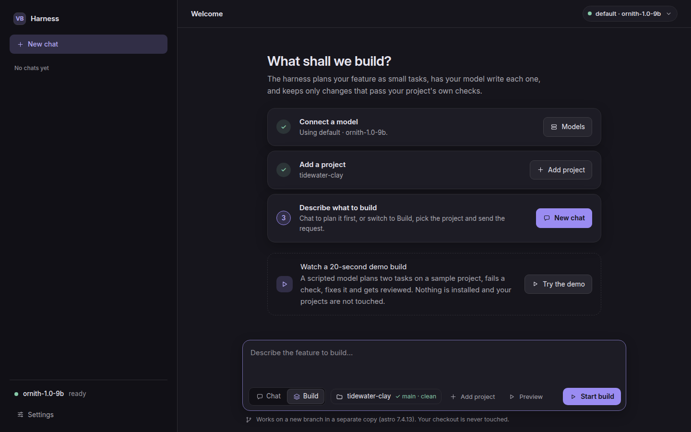

**Why the minimal template:** the harness plans against the files that exist. A starter full of example pages
gives the planner more to read and more to get wrong. The minimal template has one page and nothing else.

## 3. Give the harness a type checker

The minimal template has no `astro check`, so the only check that could prove a task is `astro build`. A build
passes for a component that no page uses yet, which proves very little. Add the checker and commit it:

```bash
npm install -D @astrojs/check typescript
git commit -am "Add astro check and TypeScript"
```

Now the Astro stack's gates are `typecheck` (`astro check`) and `build` (`astro build`), plus `unit`, `e2e`,
`format` and `lint`, which this project has no tools for. That is fine: at intake the harness runs every gate once
as a baseline, sees which cannot run, says so at the top of the report ("Gate not run"), and does not offer them
to the planner.

## 4. Choose the theme

Decide the theme before you ask for code. A model asked for "a nice warm palette" will invent one, and every
component will invent its own. Give it exact values and a job for each.

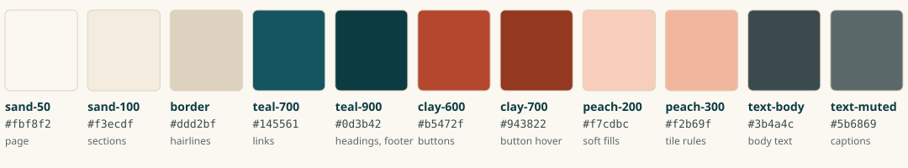

| Token | Value | Job |
| --- | --- | --- |
| `sand-50` | `#fbf8f2` | page background |
| `sand-100` | `#f3ecdf` | alternate sections, placeholder tiles |
| `border` | `#ddd2bf` | hairlines and card borders |
| `teal-700` | `#145561` | links |
| `teal-900` | `#0d3b42` | headings, the footer band |
| `clay-600` | `#b5472f` | buttons, and nothing else |
| `clay-700` | `#943822` | button hover, the hero eyebrow |
| `peach-200` | `#f7cdbc` | soft fills |
| `peach-300` | `#f2b69f` | the thin rule on placeholder tiles |
| `text-body` | `#3b4a4c` | body text |
| `text-muted` | `#5b6869` | captions |
| on the dark band | `#c2d6d5` | footer text on teal-900 |

Type: a serif for headings (`"Palatino Linotype", Palatino, Georgia, serif`) and the system sans for body text.
No web fonts, so there is nothing to download and nothing to wait for. Cards use a 6px radius and spacing follows
an 8px rhythm.

**Why these rules:** warm sand grounds with a deep teal read as calm and handmade, which suits a pottery studio.
Keeping clay for buttons only means the one action on the page ("Book a class") is the only warm, saturated thing
on it.

## 5. Plan in Chat first

Chat mode talks to the same model without touching the repository. Use it to settle the questions a plan
depends on, so the Build request can be exact. The first message:

```text
I'm starting a landing page for Tidewater Clay, a small pottery studio, in a fresh Astro project (minimal
template, nothing else yet).

The palette I picked:
- Grounds: sand-50 #fbf8f2 (page), sand-100 #f3ecdf (alternate sections), border #ddd2bf
- Teal: teal-700 #145561, teal-900 #0d3b42
- Clay: clay-600 #b5472f, clay-700 #943822
- Peach: peach-200 #f7cdbc, peach-300 #f2b69f
- Text: body #3b4a4c, muted #5b6869
Type: a serif for headings (Palatino or Georgia), the system sans for body text. No web-font downloads.

Help me plan it before I ask for code: which sections should the page have, how would you split it into Astro
components, which colour should do which job, and what should I decide first? Keep it a plan, no full code.
```

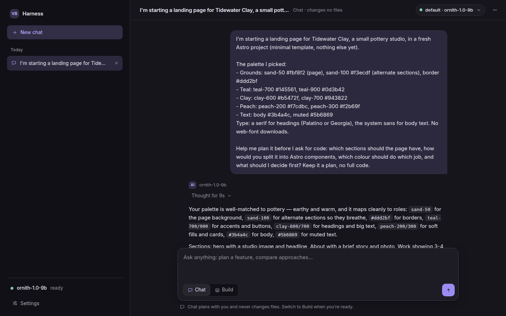

The answer came back in 80 seconds (9 of them thinking). It was short and confident, and half of it was wrong for
this page:

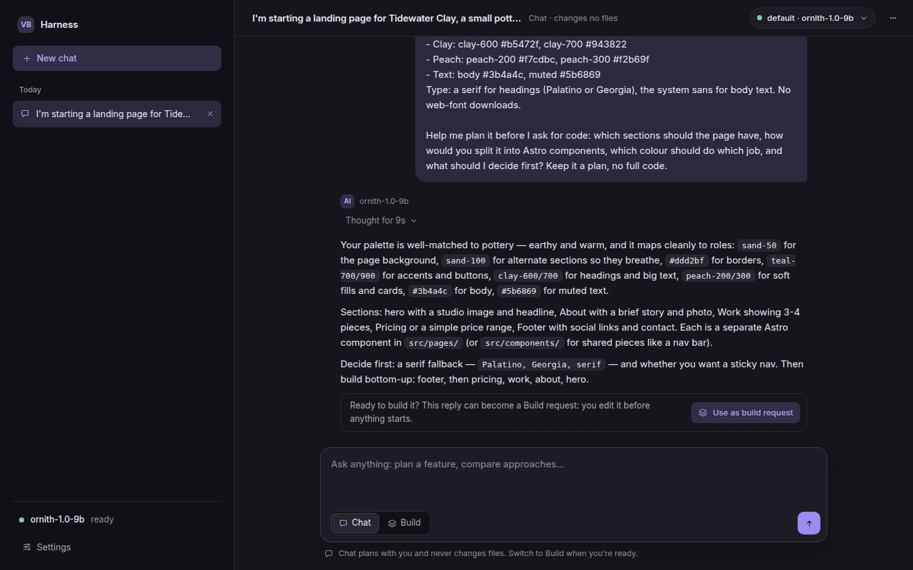

- **Colours the other way round:** teal for accents and buttons, clay for headings. The point of the palette is
  the reverse.
- **Sections for a studio that does not exist yet:** a hero with a studio photo, About, Work, Pricing.
- **Components in `src/pages/`.** In Astro every file there becomes its own URL.
- **"Decide first": the serif fallback and a sticky nav.** Neither is what the plan depends on.

A small model's plan needs reading, not accepting. The reply answered for it and corrected each point:

```text
Answers and corrections:
1. Classes come first, pieces second. The one primary action is "Book a class"; there is no booking system yet,
   so the button is a mailto link to hello@example.com.
2. No photos yet. Use CSS-only placeholder tiles (sand-100 fill with a thin peach-300 rule), no image files.
3. For v1: Header, Hero, Classes, Pieces, Footer. No About, no pricing, no contact form; Visit (hours, address,
   email) goes in the footer. No sticky nav.
4. Colours the other way round from your plan: headings are teal-900, links teal-700, and clay is only for the
   "Book a class" button. Headings never use clay.
5. Sections go in src/components/ and are rendered by the one page, src/pages/index.astro. A file in src/pages/
   becomes its own URL.

The build tool I'm using changes at most 3 files per task and checks each task with astro check and astro build.
In what order should the work go, task by task?
```

The answer took 63 seconds (20 thinking):

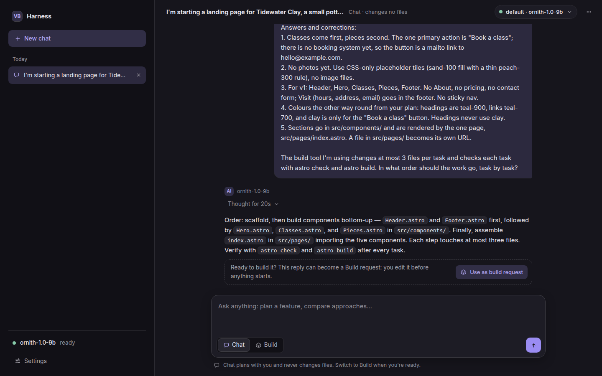

Composing `index.astro` last is right. What is missing is why the Build request should not just paste a chat answer:

- **No theme task.** The palette has nowhere to live, so each component would carry its own copy.
- **No layout.** Nothing provides the HTML shell, so the first component's `astro check` has nothing to sit in.

The Build request below fixes both: the palette goes in its own stylesheet, created first; the layout imports
no components; each component is its own task; and one last task composes the page.

## 6. Write the Build request

Switch the text box to **Build**, pick the project and choose **Start build** with this request:

```text
Build the landing page for Tidewater Clay, a small pottery studio. Static page only: no client JavaScript, no
images, no new dependencies, no web fonts.

Theme: create src/styles/global.css with these CSS custom properties on :root, and use only these colours
everywhere:
--sand-50: #fbf8f2; --sand-100: #f3ecdf; --border: #ddd2bf;
--teal-700: #145561; --teal-900: #0d3b42;
--clay-600: #b5472f; --clay-700: #943822;
--peach-200: #f7cdbc; --peach-300: #f2b69f;
--text-body: #3b4a4c; --text-muted: #5b6869;
--font-heading: "Palatino Linotype", Palatino, Georgia, serif;
--font-body: "Segoe UI", system-ui, -apple-system, sans-serif;
The page background is sand-50, body text is text-body in font-body, headings are teal-900 in font-heading. Links
are teal-700. Buttons are clay-600 with white text and clay-700 on hover; clay is used for nothing else. Cards use
a 6px radius; spacing follows an 8px rhythm.
Style each component in its own <style> block using only these variables. The project has no Tailwind or other
CSS framework, so do not use utility classes.

Files:
1. src/layouts/Layout.astro: the HTML shell with a title prop and a meta description; imports
   ../styles/global.css; renders a <slot />. It imports no components.
2. src/components/Header.astro: the wordmark "Tidewater Clay" and nav links to #classes, #pieces and #visit.
3. src/components/Hero.astro: eyebrow text "Hand-thrown in small batches" in clay-700, a heading, one short
   paragraph, a "Book a class" button that is a mailto:hello@example.com link, and a secondary text link "See the
   pieces" to #pieces.
4. src/components/Classes.astro: section id="classes" on sand-100 with three cards (Taster evening, 2 hours;
   Six-week wheel course; Glazing day), each with a name, a length and one sentence. The cards are not links.
5. src/components/Pieces.astro: section id="pieces" with three placeholder tiles (Mugs, Bowls, Planters): a
   sand-100 block with a thin peach-300 top border and a caption.
6. src/components/Footer.astro: id="visit" on teal-900 with white headings and #c2d6d5 text: opening hours, an
   address placeholder, and hello@example.com.
7. src/pages/index.astro: uses Layout and renders Header, Hero, Classes, Pieces and Footer in that order.
```

Why each part is there:

| Line | Why |
| --- | --- |
| "Static page only: no client JavaScript, no images, no new dependencies, no web fonts" | Rules out whole classes of task: installs (which the harness will not run), image files, font downloads, hydration. |
| The full token list with values | The model copies exact values. Without them, every component invents its own colours. |
| "Buttons are clay-600 … clay is used for nothing else" | Settles the colour roles from the chat in the request itself. |
| "Style each component in its own `<style>` block … no Tailwind" | Small models reach for Tailwind classes by habit. In a project without Tailwind they compile, and do nothing. |
| A numbered file list | The planner turns each file into a task that fits the 3-file limit. Paths are exact, so no task guesses where a file lives. |
| "It imports no components" | Lets the layout pass its checks before any component exists. |
| Exact text ("Hand-thrown in small batches", the class names) | Wording is a value too. Give it, or the model writes its own. |
| index.astro last | The only file that imports everything, so it is the only task that has to wait for all the others. |

The app adds a build card under the request and streams the run into it: a progress bar through Plan, Tasks,
Final checks, Review and Report, and a **Now** line that says in plain words what the model is doing.

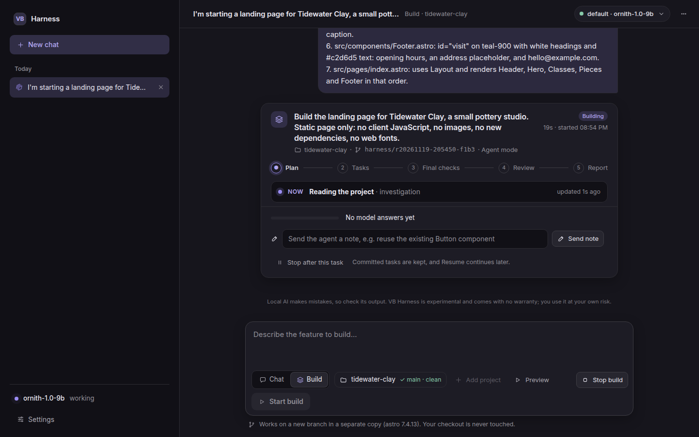

## 7. Run 1: one task did the work of four

The planner made the eight tasks the request lists, one per file. Run 1 took 46 minutes and failed: five tasks
committed, three blocked.

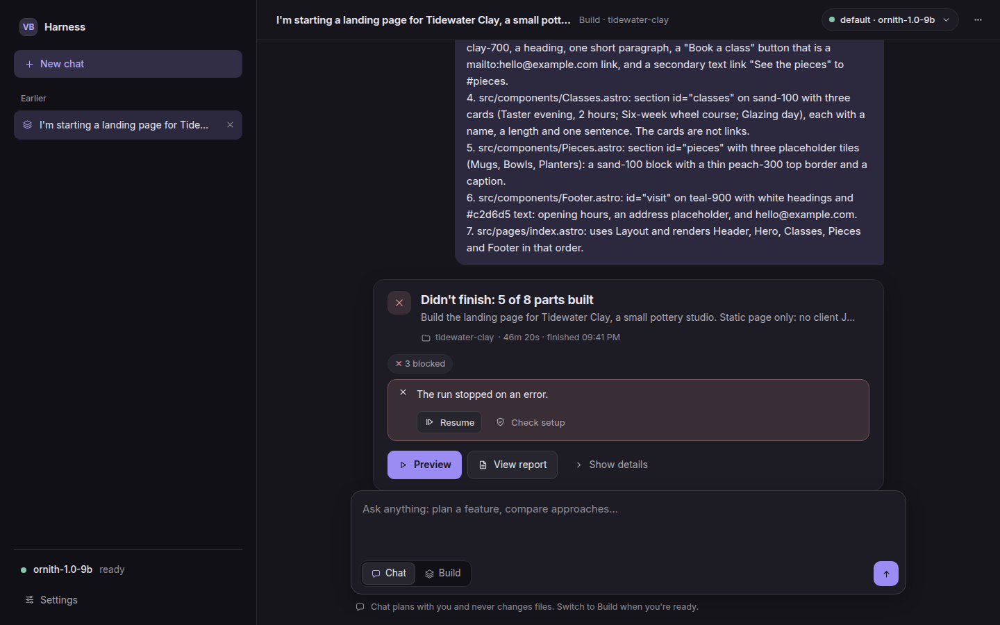

The report says which three, and why, in its first lines:

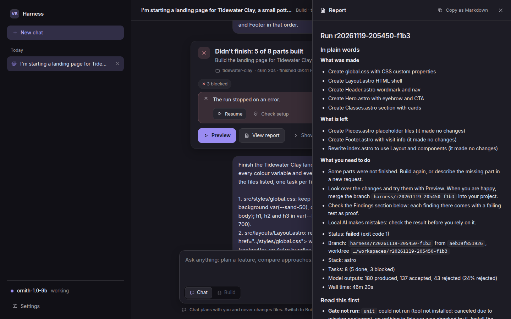

Pieces, Footer and `index.astro` were blocked because **they made no changes**, and the cause was one task
earlier. T4 was told to create `Hero.astro`. It also rewrote `index.astro` to render every section. `astro check`
then failed on the components that did not exist yet, so the agent created them too: `Classes`, `Pieces` and
`Footer`, all in T4's commit. When T6 to T8 came to do their work, it was done. The harness refuses a task that
changes nothing, since a task that claims success without a diff is usually a task that did nothing, so each was
blocked, and the run failed.

Two lessons, one for you and one for the harness:

- **Agent mode lets a task reach past its own files.** The check that fails is real, and the agent fixes it the
  quickest way it can. Here that meant doing three other tasks' work, unreviewed by their own steps.
- **"Made no changes" is not always a failure.** The work was there and it type-checked. The card's "The run
  stopped on an error" makes it sound worse than it was. Both are noted as harness follow-ups.

The model made smaller mistakes as well, and the harness caught each one. Of 180 outputs, 43 (24%) were
rejected. Most were tool calls the agent got wrong: commands that do not exist (`create_file`), or reading a
file before creating it. Each was refused with the reason, and the agent tried again.

The page it built:

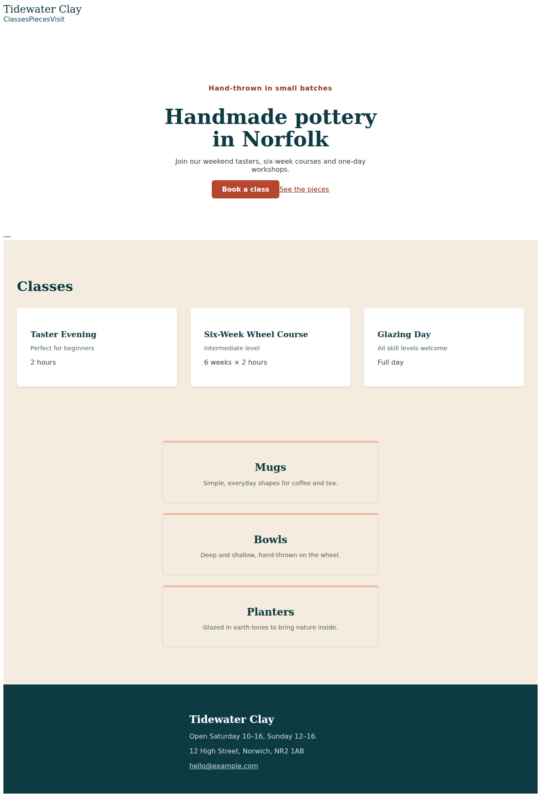

Reading it against the request found what the gates could not:

- `global.css` has the variables but no rules for the body, headings or links. The planner shortened T1's
  intent and dropped them, so the background is white.
- The layout links the stylesheet with `<link href="../styles/global.css">`, which Astro does not bundle; the
  variables only work because the header imports the file.
- `Classes.astro` starts with three `---` lines. Astro takes the first two as frontmatter and prints the third.
  The cards are white with shadows, and the names are capitalised ("Taster Evening").
- The footer invented an address, "12 High Street, Norwich, NR2 1AB".

None of that is a failed check: all of it compiles and builds.

## 8. Run 2: a fix list, one task per file

Run 1's commits were good work in the wrong shape, so they were merged and the next request listed what to fix,
one file per task, each line naming the cause:

```text
Finish the Tidewater Clay landing page so it matches the original request. Keep every colour variable and every piece of text that is not named here. Change only the files listed, one task per file; each file already exists.

1. src/styles/global.css: keep the :root variables and add: body with margin 0, background var(--sand-50), color var(--text-body) and font-family var(--font-body); h1, h2 and h3 in var(--font-heading) and var(--teal-900); a in var(--teal-700).
2. src/layouts/Layout.astro: replace the <link rel="stylesheet" href="../styles/global.css"> with an import of "../styles/global.css" in the frontmatter, so Astro bundles it. Nothing else changes.
3. src/components/Header.astro: remove the global.css import (the layout imports it now) and the inline style attributes; style it in its own <style> block: the wordmark on the left in var(--font-heading), the nav on the right with 24px between links.
4. src/components/Hero.astro: the "See the pieces" link is var(--teal-700), not clay; clay is only for the button. Put 24px between the button and the link.
5. src/components/Classes.astro: the file starts with three "---" lines and the third one shows on the page; remove all three (the file needs no frontmatter). Move every inline style attribute into one <style> block. The card names are exactly "Taster evening", "Six-week wheel course" and "Glazing day". Each card is on var(--sand-50) with a 1px var(--border) border, a 6px radius, no shadow and no white.
6. src/components/Pieces.astro: add an h2 "Pieces" above the tiles. Each tile is a var(--sand-100) block 160px tall with a 4px var(--peach-300) top border and a 6px radius, and its caption (Mugs, Bowls, Planters) is an h3 under the block. The section background is var(--sand-50).
7. src/components/Footer.astro: the address is a placeholder: replace "12 High Street, Norwich, NR2 1AB" with "Address to follow".
```

It took 1 h 23 min and failed the same way: six tasks committed, and T7 blocked because T6, editing `Pieces.astro`,
had already replaced the footer's address. The content was now right everywhere.


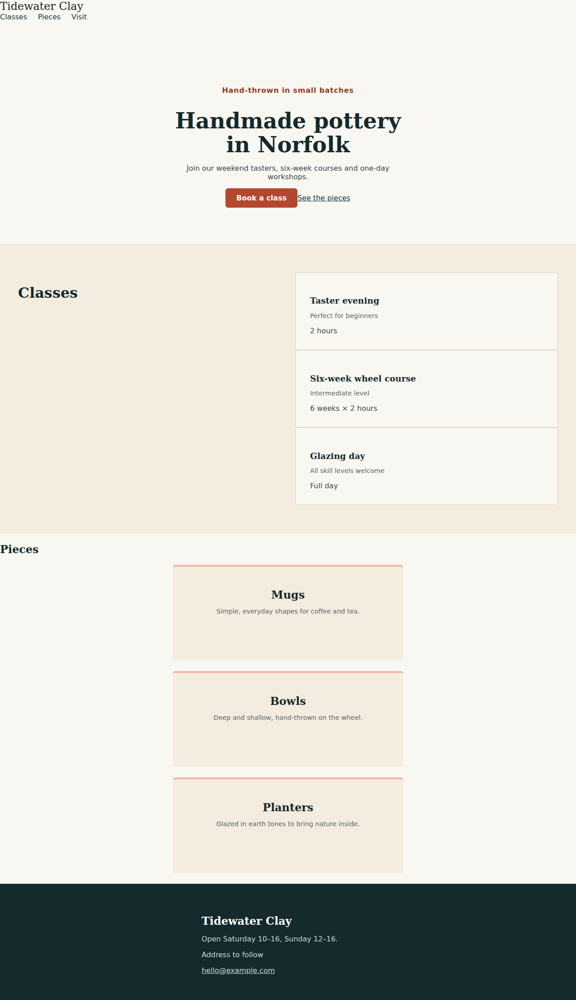

**The lesson for your own runs:** a failed run is not lost work. Read what it committed, merge what is right, and
send the rest as a new request. And read the page as well as the report: every gate passed on both of these
runs, and neither page was what was asked for.

## 9. Runs 3 and 4: a layout pass, then its fixes

The content was right and the page had no layout: the header in a column at the left edge, the class cards
beside their heading, the tiles stacked. So run 3 was about layout only, with numbers for everything:

```text
Lay out the Tidewater Clay landing page. Keep every colour variable and every piece of text. Change only the files listed, one task per file; each file already exists.

1. src/components/Header.astro: remove the :root block from its <style> (the colours live in global.css only) and the empty frontmatter. The header is a flex row: wordmark on the left, nav on the right, items centred vertically, padding 16px 24px, max-width 1080px, centred with margin 0 auto.
2. src/components/Hero.astro: put the button and the "See the pieces" link in one flex row, centred, with a 24px gap, 24px below the paragraph.
3. src/components/Classes.astro: the h2 "Classes" sits above the cards, not beside them. The three cards are a 3-column grid with a 24px gap, inside a container 1080px wide, centred, with 24px side padding. Below 720px the grid is one column.
4. src/components/Pieces.astro: the same container as Classes (1080px, centred, 24px side padding) with the h2 inside it. The three tiles are a 3-column grid with a 24px gap; below 720px it is one column.
```

Four tasks, all committed, in 38 minutes, and the run finished `done`. The colours were fixed (the header had been
redefining them with a wrong teal) and the pieces were a grid. Three things were still wrong, and the page showed
it at once:

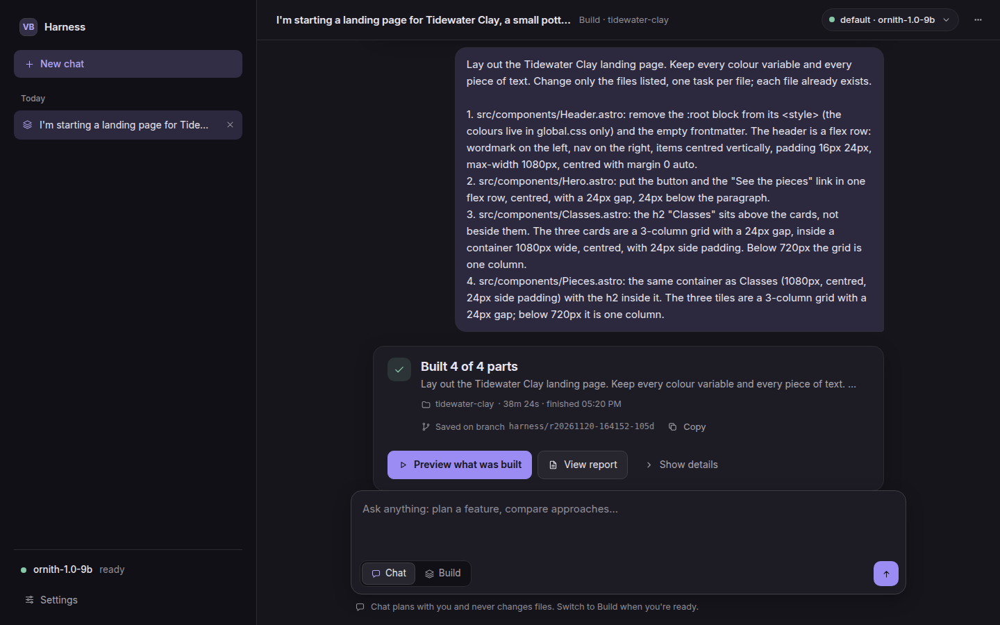

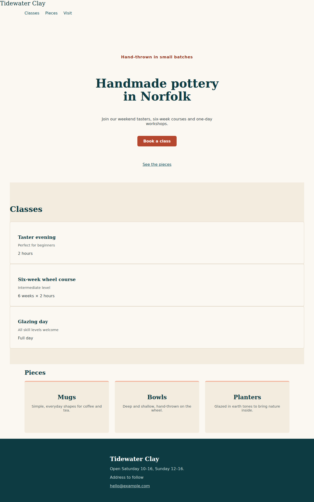

The causes were in the code:

- **Header:** the flex row went on the `<nav>`, not on the `<header>` that holds the wordmark and the nav.
- **Hero:** the button and the link had no wrapper, so "one flex row" became the whole hero in a column.
- **Classes:** the grid rule pointed at the wrong `div`, and a stray `}` after a media query broke the rules
  after it. `astro check` checks types and templates, not CSS, so it passed.

The review had noticed two of these. They are in the report's **Questions**, as claims no test could confirm:
"Below 720px the grid is one column. The diff never changes the grid…". Questions are worth reading when the
page looks wrong; that is where the review's doubts go.

Run 4 named each cause and its fix, with class names, one file each:

```text
Three layout fixes on the Tidewater Clay page. Keep every colour, every class name not named here and every piece of text. Change only the files listed, one task per file.

1. src/components/Header.astro: the flex row belongs on the header, not the nav. Give <header> the class "site-header" and style .site-header with display flex, justify-content space-between, align-items center, padding 16px 24px, max-width 1080px and margin 0 auto. .nav-links keeps display flex and gap 24px but loses its padding, max-width and margin.
2. src/components/Hero.astro: wrap the "Book a class" button and the "See the pieces" link in one <div class="hero__actions">. Style .hero__actions with display flex, flex-direction row, align-items center, justify-content center and gap 24px.
3. src/components/Classes.astro: the <style> block has a stray "}" after the media queries that breaks the CSS; rewrite the block so its braces balance. Give the div that holds the three cards the class "cards" and style .cards with display grid, grid-template-columns repeat(3, 1fr) and gap 24px; inside @media (max-width: 720px), .cards has grid-template-columns 1fr. Remove the "#classes > div:last-child" rule.
```

Three tasks, all committed, in 31 minutes, with no questions in the report:

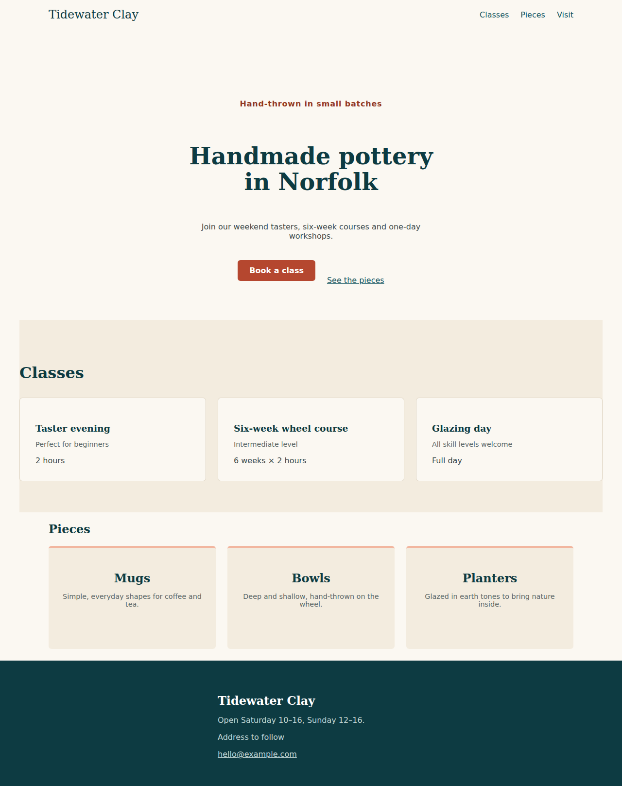

## 10. Runs 5 to 7: make it look finished

The page was right and laid out, and it still looked unfinished. The tiles were empty boxes, the class band
stopped short of the page edges, and the hero was a column of text in a lot of space. Run 5 asked for drawings
as inline SVG, so there are still no image files, and for room inside every box:

```text
Make the Tidewater Clay page look finished: drawings instead of empty tiles, and room inside every box. Keep every colour variable, every piece of text and the class names not named here. Change only the files listed, one task per file. The drawings are inline <svg> elements written in the component, not image files. Colour their shapes with classes styled in the component's <style> block (for example .pot { fill: var(--teal-700); }), never with fill attributes or hex values. Clay stays for the button only.

1. src/components/Hero.astro: make the hero two columns inside a 1080px container, centred, with padding 96px 24px 80px: the text on the left, aligned left, and on the right an inline <svg viewBox="0 0 240 240"> drawing of a vase: a rounded body (path) in var(--teal-700), a narrow neck (rect) in var(--teal-900), a band across the body in var(--peach-300), and a soft ellipse shadow under it in var(--sand-100). The svg is 280px wide. Below 720px it is one column with the drawing under the text, 200px wide. The button and the "See the pieces" link stay in .hero__actions, but the link loses its margin-top and the button loses its margin-bottom, so both sit on one line, and .hero__actions is aligned left.
2. src/components/Classes.astro: the sand-100 band runs the full width of the page. Remove the second #classes rule (max-width 1200px) and both media queries on #classes. #classes has padding 64px 0. Give the div inside the section the class "container": max-width 1080px, margin 0 auto, padding 0 24px. Each .card has padding 32px 24px, and its h3 has margin 0 0 8px.
3. src/components/Pieces.astro: the section has padding 64px 0 and moves its inline style into the <style> block. Each .tile loses its fixed height and margin-bottom, has padding 32px 24px 24px, and shows an inline <svg viewBox="0 0 120 120"> drawing 96px tall above its h3, centred: Mugs a mug (a rounded rect body and a ring handle) in var(--teal-700); Bowls a wide bowl (a half-ellipse path) in var(--teal-700) with a var(--peach-300) rim line; Planters a tapered pot (a trapezoid path) in var(--teal-900) with three leaves (ellipses) in var(--teal-700). Keep each tile's h3 and caption text.
```

Three tasks, all committed, in 1 h 15 min. It shared the model server with another run for much of that time, so
it was slower than it needed to be. The layout came out right: a two-column hero with the button and link on
one line, a full-width class band, and padded cards. The drawings did not:

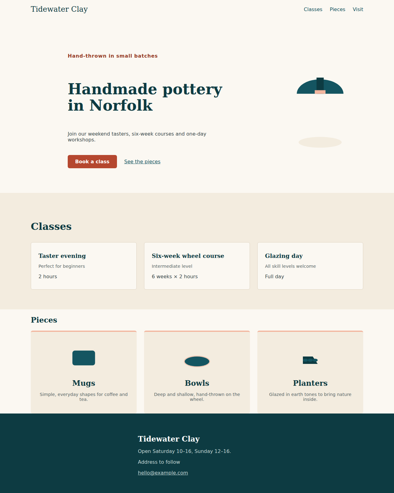

The vase is a dome on a stem, the mug has no handle, and the planter is upside down. It also put the colours in
`fill="var(…)"` attributes, which the request said not to do. That works in browsers, so it was left. The review
missed the drawings: a model that cannot draw a vase cannot tell that one is not a vase. And `padding 64px 0` on
the pieces section never landed; that one the review did raise, as a question.

Words like "a rounded body" leave a 9B model to invent geometry. Run 6 gave the geometry, the way the theme gave
colours: every shape, its coordinates and its colour, back to front.

```text
Redraw the four drawings so they look like pottery, and give the Pieces section room at the bottom. Replace only the shapes inside each existing <svg>, keep each svg's viewBox, size and class, and keep every other line of the files. Shapes are listed back to front: draw them in this order. Colours go in fill attributes as var(--name), as they are now. Change only the files listed, one task per file.

1. src/components/Hero.astro, the vase (viewBox 0 0 240 240):
   - shadow: ellipse cx 120, cy 214, rx 70, ry 12, var(--sand-100)
   - body: path "M120,70 C70,70 50,130 75,190 C85,210 155,210 165,190 C190,130 170,70 120,70 Z", var(--teal-700)
   - band: ellipse cx 120, cy 130, rx 56, ry 7, var(--peach-300)
   - neck: rect x 100, y 30, width 40, height 48, var(--teal-900)
   - lip: rect x 92, y 24, width 56, height 10, rx 4, var(--teal-900)
2. src/components/Pieces.astro, the section and its three drawings (each viewBox 0 0 120 120):
   - The .pieces section gets padding 64px 0 in the <style> block.
   - Mugs: handle first, a circle cx 92, cy 64, r 16, fill none, stroke var(--teal-700), stroke-width 8; then the body, rect x 24, y 34, width 64, height 64, rx 8, var(--teal-700); then a band, rect x 24, y 50, width 64, height 8, var(--peach-300).
   - Bowls: the bowl, path "M12,50 A48,40 0 0 0 108,50 Z", var(--teal-700); the rim, ellipse cx 60, cy 50, rx 48, ry 8, var(--peach-300); the foot, rect x 46, y 86, width 28, height 8, rx 2, var(--teal-900).
   - Planters: three leaves first, ellipses rx 8, ry 20 in var(--teal-700): one at cx 60, cy 34; one at cx 46, cy 42 with transform "rotate(-25 46 42)"; one at cx 74, cy 42 with transform "rotate(25 74 42)". Then the pot, path "M30,64 L90,64 L80,108 L40,108 Z", var(--teal-900); then its rim, rect x 26, y 58, width 68, height 10, rx 3, var(--teal-900).
```

Two tasks, both committed, in 27 minutes. The vase and the planter came out exactly as written, and the pieces
section got its padding. The mug and the bowl did not: T2 had four drawings and a CSS rule to get right in one
file, and for two of the drawings it wrote shapes of its own, a blob and a flat ellipse. This time the review
caught it. All three of its questions say which shapes do not match the request.

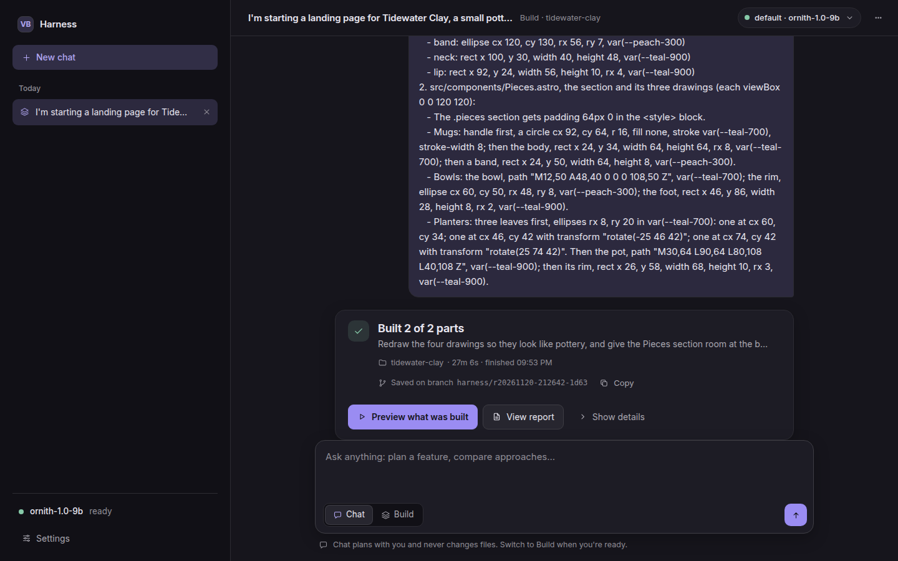

Run 7 sent the two drawings again, alone, in one file, with the review's own words as the reason:

```text
In src/components/Pieces.astro, two drawings did not follow the request: the mug is one path and the bowl is two ellipses. Replace only the shapes inside those two <svg> elements with exactly these shapes, in this order, and change nothing else in the file. Colours go in fill attributes as var(--name).

- Mugs: a circle cx 92, cy 64, r 16, fill none, stroke var(--teal-700), stroke-width 8 (the handle); then a rect x 24, y 34, width 64, height 64, rx 8, fill var(--teal-700) (the body); then a rect x 24, y 50, width 64, height 8, fill var(--peach-300) (a band).
- Bowls: a path d "M12,50 A48,40 0 0 0 108,50 Z", fill var(--teal-700) (the bowl); then an ellipse cx 60, cy 50, rx 48, ry 8, fill var(--peach-300) (the rim); then a rect x 46, y 86, width 28, height 8, rx 2, fill var(--teal-900) (the foot).
```

One task, committed in 15 minutes, with no questions. That is where this recipe stops: the page is right in
content, colour, type and layout, it has its drawings, and it works on a phone. The hero's text column still sits
a little in from the header's left edge; that would be one more sentence.


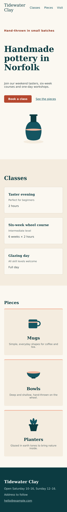

| | Run 1 | Run 2 | Run 3 | Run 4 | Run 5 | Run 6 | Run 7 |
| --- | --- | --- | --- | --- | --- | --- | --- |
| Tasks | 5 done, 3 blocked | 6 done, 1 blocked | 4 done | 3 done | 3 done | 2 done | 1 done |
| Model outputs | 180, 24% rejected | 201, 19% rejected | 115, 20% rejected | 89, 20% rejected | 148, 14% rejected | 83, 17% rejected | 35, 17% rejected |
| Tokens | 380K | 578K | 298K | 281K | 645K | 306K | 114K |
| Wall time | 46 min | 1 h 23 min | 38 min | 31 min | 1 h 15 min | 27 min | 15 min |

In all, 5 h 15 min of build runs. Tokens are the model's input and output together. Most of them are input: in agent mode each step re-sends the
conversation so far. The two chat answers took 80 and 63 seconds more. Everything ran on one consumer GPU, one
request at a time.

## 11. Review and merge

The harness never touches your checkout. Every committed task is a commit on the run's branch, in a worktree of
its own, so reviewing is ordinary git:

```bash
git log --oneline main..harness/RUN_ID
git diff main...harness/RUN_ID
```

The card's **Preview** button serves the branch so you can look at the page before merging it. Each run here was
merged before the next one started, so the next request could name the files as they were:

```bash
git merge harness/RUN_ID
```

The project's history is one commit per finished task, each named after the task the planner wrote, with a
trailer naming the model and the checks it passed, on top of the two set-up commits:

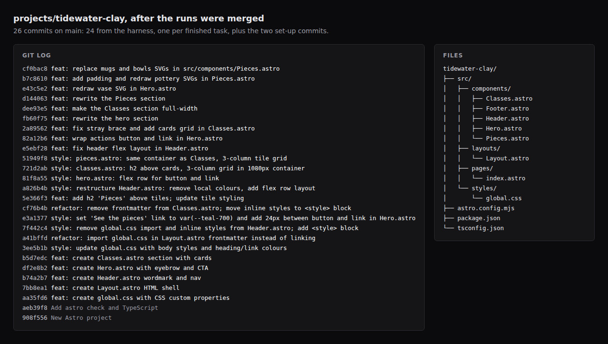

Then run the site yourself:

```bash
npm run build
npm run preview
```

## 12. What to take from this

- **Settle questions in Chat, then write an exact Build request.** Values, wording, file paths and what each file
  imports. The planner keeps what you write; it cannot keep what you did not.
- **Read the model's plan before you use it.** This one had the colours backwards and put components where they
  would become pages.
- **Gates prove it compiles, not that it is right.** Every gate passed on pages with a stray `---`, a broken
  stylesheet and a vase that was a dome. Look at the page, and read the report's **Questions**.
- **A failed run is not lost work.** Merge what was committed and send the rest. Both failures here were a task
  finding its work already done by an earlier one.
- **Iterate in small requests that name causes.** A request that says what is wrong and why ("the flex row is on
  the nav, not the header") is the one a small model gets right first time.
- **Give values, not adjectives, for anything visual.** Colours, sizes and, for drawings, coordinates. "A rounded
  vase" is a guess; a path is not.
- **Expect rejections.** Between 14% and 24% of the model's outputs were thrown away in each run, most of them tool
  calls it got wrong. That is the harness doing its job: each one was caught, explained, and tried again.
