<!-- SPDX-License-Identifier: Apache-2.0 -->
<!-- Copyright 2026 V and Bruno LLC -->

# Cookbook: an Astro landing page with a local model

This recipe builds a landing page for **Tidewater Clay**, a made-up pottery studio, from an empty folder to a
merged branch. All the code is written by a local coder model with a 16K context window, running on one machine.
It covers what was typed, what the model said, what went wrong and why each decision was made. It took seven
build runs. The first two found real gaps in the harness, which are now fixed; the third built the right page;
the fourth was a layout pass, and the last three were small fixes after reading the result. The recipe says what
each one taught.

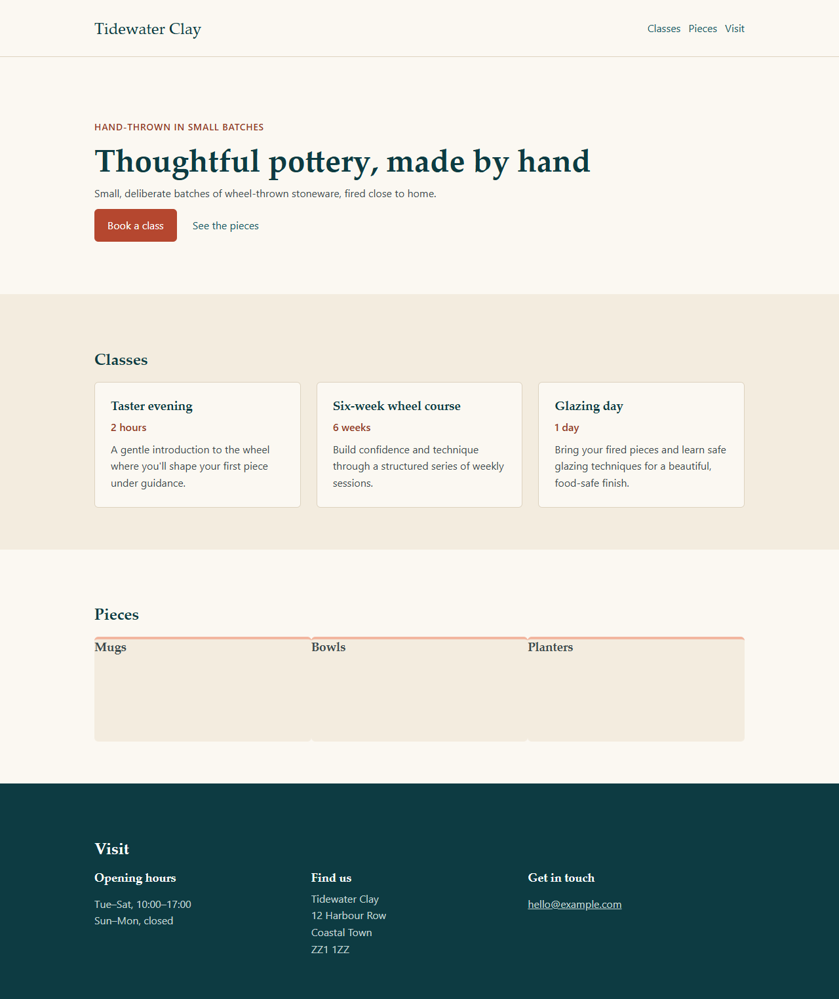

**Contents**

1. [What you need](#1-what-you-need)
2. [A new Astro project](#2-a-new-astro-project)
3. [Give the harness a type checker](#3-give-the-harness-a-type-checker)
4. [Choose the theme](#4-choose-the-theme)
5. [Plan in Chat first](#5-plan-in-chat-first)
6. [Write the Build request](#6-write-the-build-request)
7. [Run 1: two harness gaps](#7-run-1-two-harness-gaps)
8. [Run 2: it compiles, but it is not the page you asked for](#8-run-2-it-compiles-but-it-is-not-the-page-you-asked-for)
9. [Run 3: the right page, plainly laid out](#9-run-3-the-right-page-plainly-laid-out)
10. [Run 4: a layout pass](#10-run-4-a-layout-pass)
11. [Runs 5 to 7: review, then small fixes](#11-runs-5-to-7-review-then-small-fixes)
12. [Review and merge](#12-review-and-merge)
13. [What to take from this](#13-what-to-take-from-this)

## 1. What you need

- The harness installed (see [Install](../../README.md#install)) and Node.js 22 or newer for Astro.
- A model behind an OpenAI-compatible server. This recipe used **Tiel Coder 35B-A3B** (the `UD-IQ3_XXS` quant) on
  llama.cpp's server with a 16,384-token context and one request at a time. Any model works; a smaller or slower
  one only changes how long it takes.
- A model profile with room to answer. The one used here:

  ```json
  "default": {
    "baseUrl": "http://127.0.0.1:8080/v1",
    "model": "tiel-coder-35b-a3b-ud-iq3_xxs",
    "contextTokens": "probe",
    "maxOutputTokens": 4000,
    "thinking": { "control": "probe", "effort": "low" },
    "concurrency": 1,
    "timeoutSec": 1800
  }
  ```

  **Why 4,000 output tokens:** a 16K window has to hold the prompt, the files and the answer. 4,000 leaves about
  12K for context and is enough for one component's edits. When a thinking model spends all of it on thinking,
  the harness asks again with thinking off (you will see this happen below), so the budget is a ceiling, not a
  guess you have to get exactly right.

## 2. A new Astro project

In the app, choose **+ Add project → New Astro project** and type the folder name, `tidewater-clay`. The app does
not download anything yet. It shows the exact command and asks first:

```text
This downloads code from the internet and runs:

npm create astro@latest tidewater-clay -- --template minimal --install --no-git --yes

Into: projects/tidewater-clay

Continue?
```

After you confirm, it runs the command, writes a `.gitignore`, makes a git repository and commits
"New Astro project". The composer then shows the project's state: git ✓, branch `main`, clean, and the Astro
version it found.

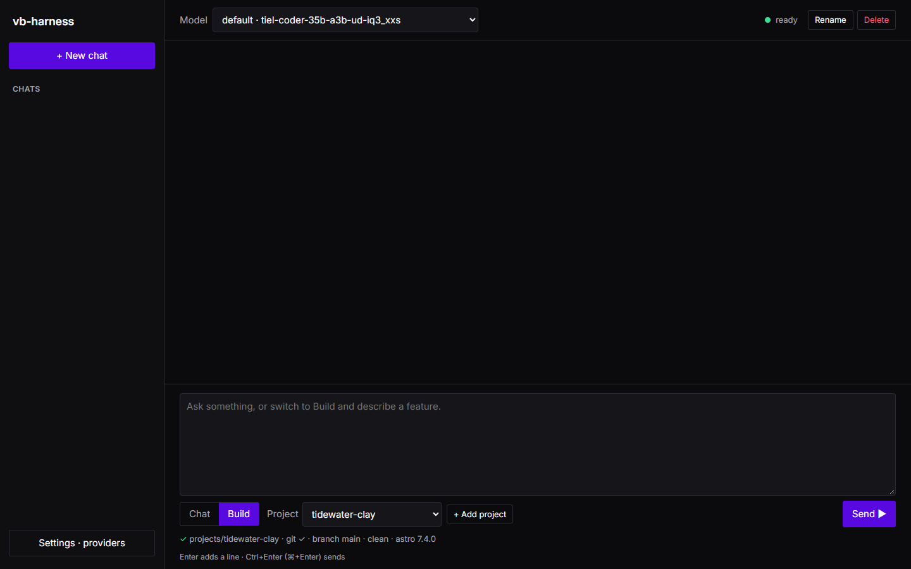

**Why the minimal template:** the harness plans against the files that exist. A starter full of example pages
gives the planner more to read and more to get wrong. The minimal template has one page and nothing else.

## 3. Give the harness a type checker

The minimal template has no `astro check`, so the only check that could prove a task is `astro build`. A build
passes for a component that no page uses yet, which proves very little. Add the checker and commit it:

```bash
npm install -D @astrojs/check typescript
git commit -am "Add astro check and TypeScript"
```

Now the Astro stack's gates are `typecheck` (`astro check`), `build` (`astro build`) and `unit` (`vitest`).
Vitest is not installed, and that is fine: at intake the harness runs every gate once as a baseline, sees that
`unit` cannot run, and does not offer it to the planner (this was one of the run 1 fixes; see below).

## 4. Choose the theme

Decide the theme before you ask for code. A model asked for "a nice warm palette" will invent one, and every
component will invent its own. Give it exact values and a job for each.

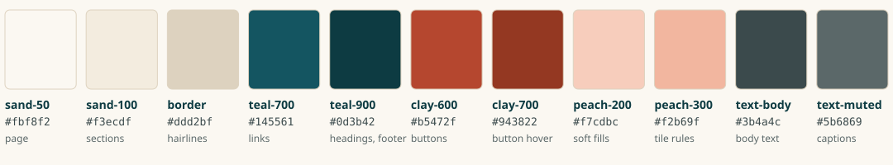

| Token | Value | Job |
| --- | --- | --- |
| `sand-50` | `#fbf8f2` | page background |
| `sand-100` | `#f3ecdf` | alternate sections, placeholder tiles |
| `border` | `#ddd2bf` | hairlines and card borders |
| `teal-700` | `#145561` | links |
| `teal-900` | `#0d3b42` | headings, the footer band |
| `clay-600` | `#b5472f` | buttons, and nothing else |
| `clay-700` | `#943822` | button hover, the hero eyebrow |
| `peach-200` | `#f7cdbc` | soft fills |
| `peach-300` | `#f2b69f` | the thin rule on placeholder tiles |
| `text-body` | `#3b4a4c` | body text |
| `text-muted` | `#5b6869` | captions |
| on the dark band | `#c2d6d5` | footer text on teal-900 |

Type: a serif for headings (`"Palatino Linotype", Palatino, Georgia, serif`) and the system sans for body text.
No web fonts, so there is nothing to download and nothing to wait for. Cards use a 6px radius and spacing follows
an 8px rhythm.

**Why these rules:** warm sand grounds with a deep teal read as calm and handmade, which suits a pottery studio.
Keeping clay for buttons only means the one action on the page ("Book a class") is the only warm, saturated thing
on it.

## 5. Plan in Chat first

Chat mode talks to the same model without touching the repository. Use it to settle the questions a plan
depends on, so the Build request can be exact. The first message:

```text
I'm starting a landing page for Tidewater Clay, a small pottery studio, in a fresh Astro project (minimal
template, nothing else yet).

The palette I picked:
- Grounds: sand-50 #fbf8f2 (page), sand-100 #f3ecdf (alternate sections), border #ddd2bf
- Teal: teal-700 #145561, teal-900 #0d3b42
- Clay: clay-600 #b5472f, clay-700 #943822
- Peach: peach-200 #f7cdbc, peach-300 #f2b69f
- Text: body #3b4a4c, muted #5b6869
Type: a serif for headings (Palatino or Georgia), the system sans for body text. No web-font downloads.

Help me plan it before I ask for code: which sections should the page have, how would you split it into Astro
components, which colour should do which job, and what should I decide first? Keep it a plan, no full code.
```

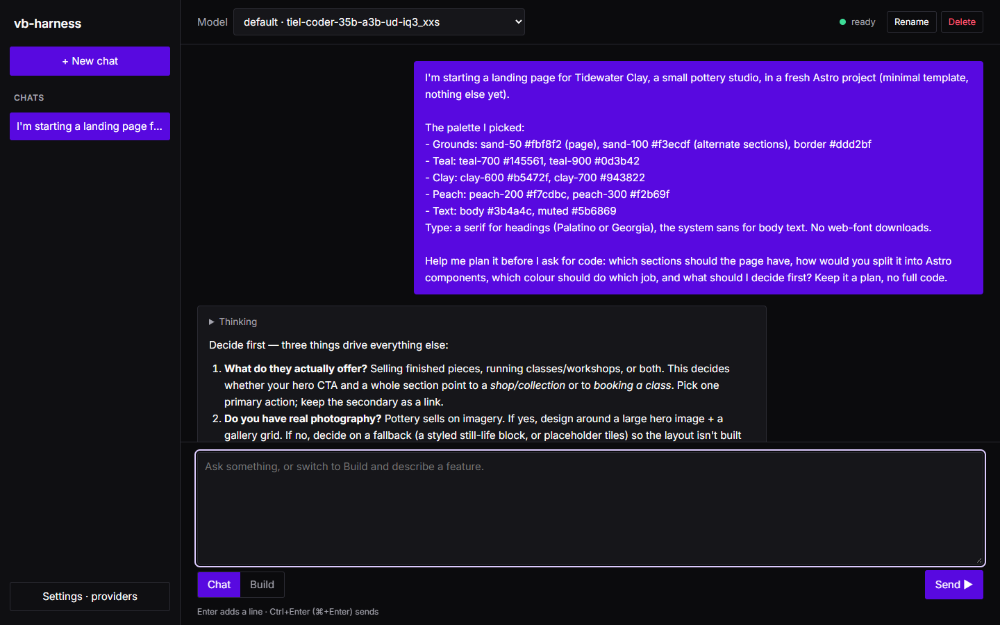

The answer was useful. It said to decide three things first (what the studio offers, whether there are photos,
and the one primary action), proposed Hero, About, Collections, Process, Visit and Footer sections, and gave
every colour a role.

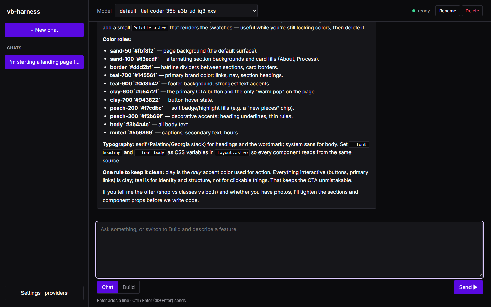

It also contradicted itself. It made teal-700 the colour for links and nav, and then said "everything interactive
(buttons, primary links) is clay". A small model's plan needs reading, not just accepting. The reply settled the
three questions and the contradiction:

```text
Answers:
1. Both, but classes come first. The one primary action is "Book a class"; there is no booking system yet, so
   the button is a mailto link to hello@example.com.
2. No photos yet. Use CSS-only placeholder tiles (sand-100 fill with a thin peach-300 rule), no image files.
3. For v1, drop Process and the contact form. Visit (hours, address, email) goes in the footer.

One correction: you put links in teal but also said everything interactive is clay. I'll keep nav and inline
links teal-700, and use clay only for buttons.

The build tool I'm using changes at most 3 files per task and checks each task with astro check and astro build.
In what order should the work go, task by task?
```

The model's first attempt at this answer spent its whole output allowance thinking and returned nothing. The app
asked again with thinking off and shows that it did:

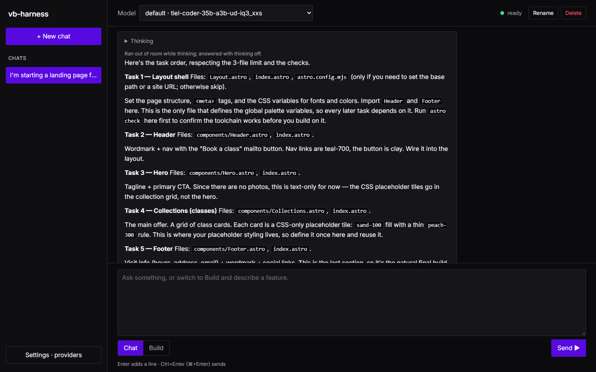

The task order it proposed is a good example of why the Build request should not just paste a chat answer:

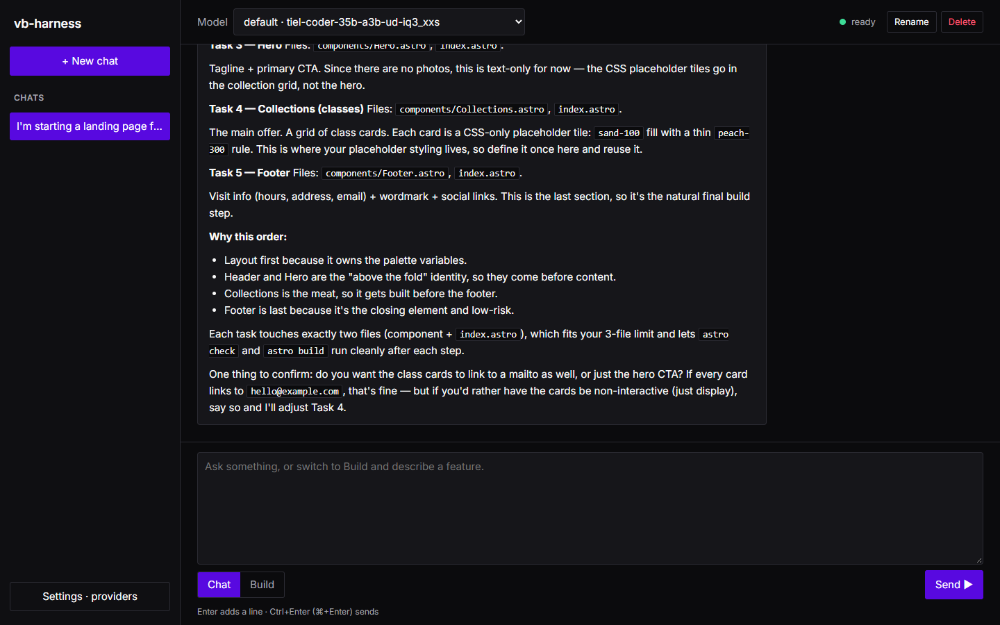

- **Every task edits `index.astro`.** Five tasks writing one file is five chances for an edit to miss the text it
  expects to find.
- **Task 1's layout imports Header and Footer**, which do not exist until tasks 2 and 5. Task 1's `astro check`
  would fail on the missing imports, so it could never pass on its own.
- **The palette lives in `Layout.astro`.** Components then depend on the layout for their variables, even though
  they never import it.

The Build request below fixes all three: the palette goes in its own stylesheet, created first; the layout imports
no components; each component is its own task; and one last task composes the page.

## 6. Write the Build request

Switch the composer to **Build**, pick the project and send this:

```text
Build the landing page for Tidewater Clay, a small pottery studio. Static page only: no client JavaScript, no
images, no new dependencies, no web fonts.

Theme: create src/styles/global.css with these CSS custom properties on :root, and use only these colours
everywhere:
--sand-50: #fbf8f2; --sand-100: #f3ecdf; --border: #ddd2bf;
--teal-700: #145561; --teal-900: #0d3b42;
--clay-600: #b5472f; --clay-700: #943822;
--peach-200: #f7cdbc; --peach-300: #f2b69f;
--text-body: #3b4a4c; --text-muted: #5b6869;
--font-heading: "Palatino Linotype", Palatino, Georgia, serif;
--font-body: "Segoe UI", system-ui, -apple-system, sans-serif;
The page background is sand-50, body text is text-body in font-body, headings are teal-900 in font-heading. Links
are teal-700. Buttons are clay-600 with white text and clay-700 on hover; clay is used for nothing else. Cards use
a 6px radius; spacing follows an 8px rhythm.
Style each component in its own <style> block using only these variables. The project has no Tailwind or other
CSS framework, so do not use utility classes.

Files:
1. src/layouts/Layout.astro: the HTML shell with a title prop and a meta description; imports
   ../styles/global.css; renders a <slot />. It imports no components.
2. src/components/Header.astro: the wordmark "Tidewater Clay" and nav links to #classes, #pieces and #visit.
3. src/components/Hero.astro: eyebrow text "Hand-thrown in small batches" in clay-700, a heading, one short
   paragraph, a "Book a class" button that is a mailto:hello@example.com link, and a secondary text link "See the
   pieces" to #pieces.
4. src/components/Classes.astro: section id="classes" on sand-100 with three cards (Taster evening, 2 hours;
   Six-week wheel course; Glazing day), each with a name, a length and one sentence. The cards are not links.
5. src/components/Pieces.astro: section id="pieces" with three placeholder tiles (Mugs, Bowls, Planters): a
   sand-100 block with a thin peach-300 top border and a caption.
6. src/components/Footer.astro: id="visit" on teal-900 with white headings and #c2d6d5 text: opening hours, an
   address placeholder, and hello@example.com.
7. src/pages/index.astro: uses Layout and renders Header, Hero, Classes, Pieces and Footer in that order.
```

Why each part is there:

| Line | Why |
| --- | --- |
| "Static page only: no client JavaScript, no images, no new dependencies, no web fonts" | Rules out whole classes of task: installs (which the harness will not run), image files, font downloads, hydration. |
| The full token list with values | The model copies exact values. Without them, every component invents its own colours. |
| "Buttons are clay-600 … clay is used for nothing else" | Settles the contradiction from the chat in the request itself. |
| "Style each component in its own `<style>` block … no Tailwind" | Added after run 2, where a component used Tailwind classes in a project without Tailwind. They compile, and do nothing. |
| A numbered file list | The planner turns each file into a task that fits the 3-file limit. Paths are exact, so no task guesses where a file lives. |
| "It imports no components" | Lets the layout pass its checks before any component exists. |
| Exact text ("Hand-thrown in small batches", the class names) | Wording is a value too. Give it, or the model writes its own. |
| "The cards are not links" | Answers the question the model asked at the end of the chat. |
| index.astro last | The only file that imports everything, so it is the only task that has to wait for all the others. |

The app adds a build card under the request and streams the run into it: plan, tasks, integration, final review
and report.

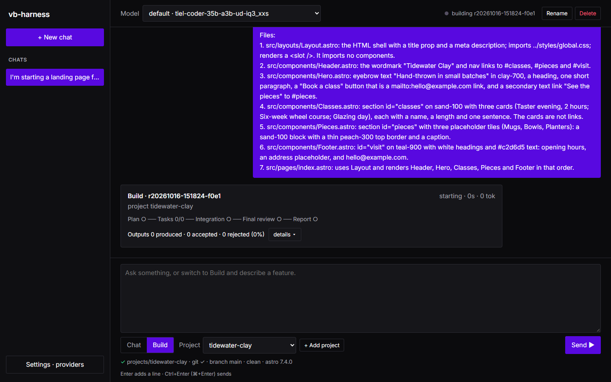

## 7. Run 1: two harness gaps

The first run (without the styling line above) failed: one task done, one blocked, six skipped, and 16 of 27 model
outputs rejected.

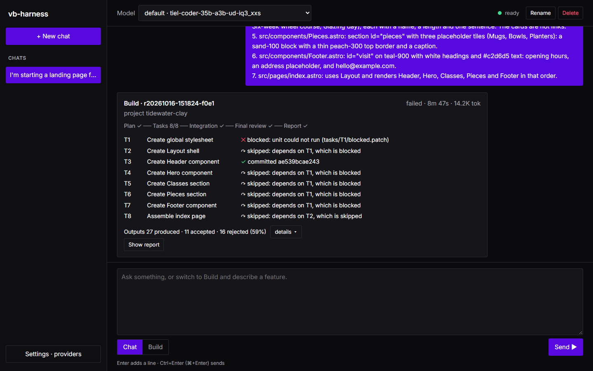

Reading the events showed two problems in the harness, not in the model:

- **A task could not read a file an earlier task creates.** The planner correctly planned "T1 creates
  `global.css`, T2 reads it", and the plan check refused it because `global.css` did not exist yet. A task may
  now read or modify any file that a task it depends on creates, and the refusal says to add the creating task
  to `dependsOn`.
- **The planner was offered a gate that could not run.** It proved T1 with the `unit` gate, Vitest was not
  installed, so T1 was blocked at its gates and everything after it was skipped. The planner is now told only
  about gates the baseline could run, a plan that names any other is sent back (`plan.gate_unavailable`), and
  when no test gate can run the prompt says so.

The model made mistakes too (a reply with a duplicate JSON key, a test item pointing at a page), and the harness
rejected each one and asked again. That is the job it is built for.

## 8. Run 2: it compiles, but it is not the page you asked for

Run 2 used the fixed harness. Seven of eight tasks were committed; the last, composing `index.astro`, was blocked
after three fix rounds.

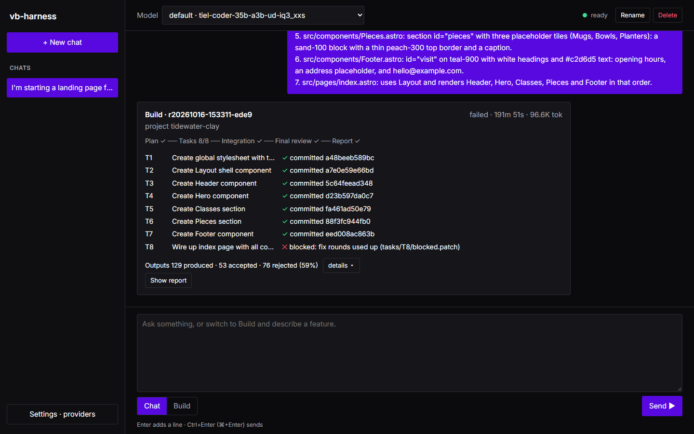

Three more things came out of it:

- **A crash.** `astro check` reported one diagnostic with a code and three without one, and comparing them raised
  a Ruby error. The app's build thread died and the run sat at "running" with no explanation. The comparison is
  fixed, a crashed run is now marked failed with a `harness.crashed` event, and `harness resume RUN_ID` continued
  this one from the last committed task.
- **A guessed import path.** T8's last error was `Cannot find module '../components/Layout.astro'`, for a file at
  `src/layouts/Layout.astro`. The fixer had no way to see where the file is, so it guessed three times. Now a
  "cannot find module" diagnostic comes with the repository files of that name.
- **The theme was wrong, and every gate passed.** Reading the committed code showed invented colours (`#1f7a7a`
  instead of `#145561`), variables that do not exist (`--clay-800`), Tailwind classes in a project without
  Tailwind, and a footer that imports itself. The cause was in the harness: the planner had shortened T1 to "the
  required CSS custom properties", and the implementer only saw the task, never the request with the values. Now
  the implementer and fixer see the request itself, fenced as data, and the planner is told to copy exact values
  into the tasks and to make a component that uses the theme depend on the stylesheet and read it.

**The lesson for your own runs:** gates prove the code compiles and builds. They do not prove it matches the
request. Read the diff before you merge, and when a run is wrong in a way the gates cannot see, the fix usually
belongs in the request.

## 9. Run 3: the right page, plainly laid out

Run 3 sent the same request again, with the styling line added, to the fixed harness. All eight tasks were
committed and the run finished `done`.

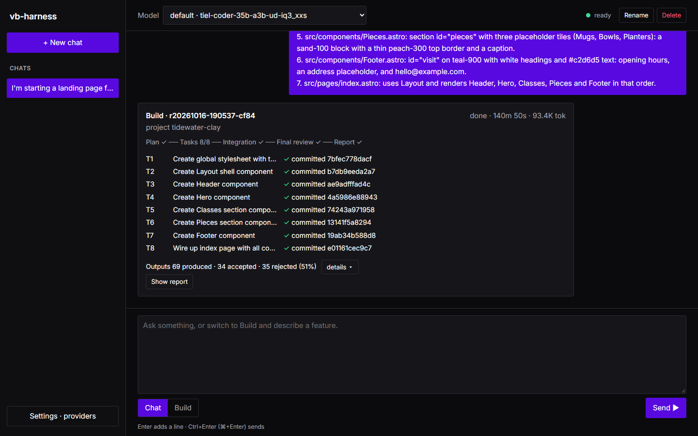

This time the plan kept the values. T1's intent listed every token by name, its `global.css` has exactly the
colours of the request, every component task depends on T1 and reads `global.css`, and the hero says "Hand-thrown
in small batches". T8, which had failed three times in run 2, passed on its first try.

The report lists each task with its commit, fix rounds and the gates that proved it:

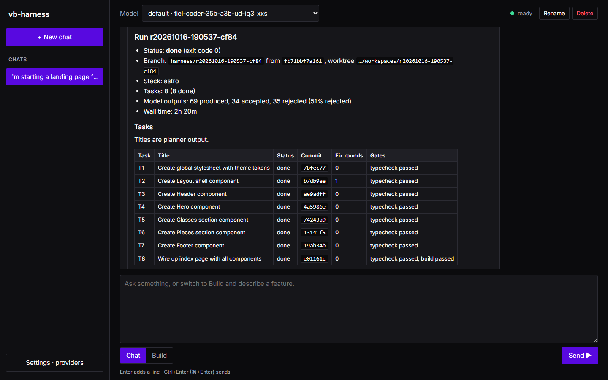

The numbers, for a sense of what a 16K local model costs:

| | Run 3 |
| --- | --- |
| Tasks | 8 done |
| Model outputs | 69 produced, 34 accepted, 35 rejected (51%) |
| Tokens | 93.4K |
| Wall time | 2 h 20 min, on one consumer GPU, one request at a time |

The most common rejections were replies that ran out of output room (13), claims the
review's challenge step defended (6), and claims the code itself refuted (4). Each one was thrown away and asked
again.

Halfway through, the verifier's replies were taking 5 to 7 minutes each: thinking until the output allowance ran
out, then answering in seconds with thinking off. That led to one more harness change, made during this run (the
run was stopped and continued with `harness resume`): after two such replies, a role asks with thinking off from
the start for the rest of the run. After that, the remaining tasks and the final review took about an hour.

The page was right, and plain:

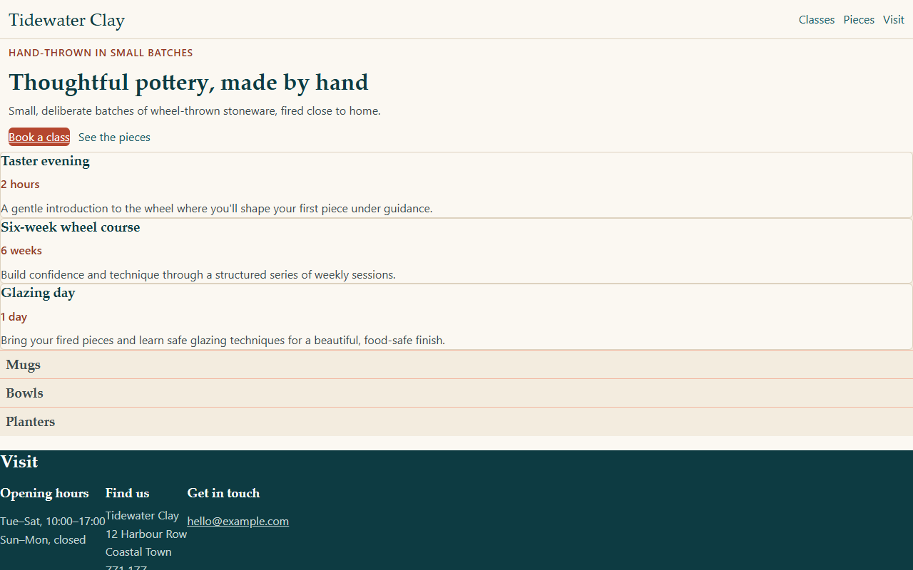

Colours, type and wording all match the request. What the request never said is visible too: there is no page
container, no section headings, the cards are stacked instead of side by side, and the spacing is tight. There is
also no viewport tag, so a phone would show the desktop layout shrunk. None of that is a failed check; it is a
request that gave values but no layout.

## 10. Run 4: a layout pass

So the next request is about layout only. It keeps every colour and word, and gives numbers the same way the
theme did:

```text
Polish the landing page's layout. Keep every colour, font and piece of text as it is, and use only the existing CSS variables; change spacing and layout only.

1. src/layouts/Layout.astro: add <meta name="viewport" content="width=device-width, initial-scale=1"> to the head.
2. src/styles/global.css: add a .container class (max-width 1040px, margin 0 auto, padding 0 24px) and make links in buttons never underlined.
3. src/components/Header.astro: put the content in a .container; the wordmark on the left and the nav on the right, 24px padding above and below, nav links 24px apart, a 1px border-colour line under the header.
4. src/components/Hero.astro: put the content in a .container with 96px padding above and 80px below; the heading 48px (32px below 720px wide); the "Book a class" button with 12px 20px padding, a 6px radius, white text and no underline; 24px between the button and the "See the pieces" link.
5. src/components/Classes.astro: the whole section on sand-100 with 64px padding above and below, content in a .container, an h2 "Classes" above the cards; the three cards in a 3-column grid with 24px gaps (one column below 720px wide); each card on sand-50 with a 1px border-colour border, a 6px radius and 24px padding.
6. src/components/Pieces.astro: 64px padding above and below, content in a .container, an h2 "Pieces"; the three tiles in a 3-column grid with 24px gaps (one column below 720px wide); each tile 160px tall, sand-100, with a 4px peach-300 top border and a 6px radius, and its caption under the tile.
7. src/components/Footer.astro: 64px padding above and below, content in a .container; the three columns in a grid with 48px gaps (one column below 720px wide).
```

Run 4 planned one task per file, with every component depending on the stylesheet task. Six of seven were
committed; T5, the classes grid, was blocked.

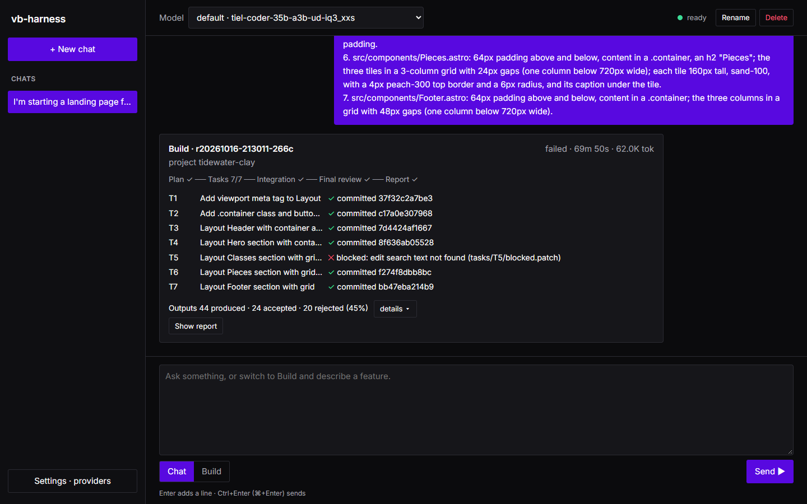

T5's reply had three edits to one file. The first changed the file, and the other two searched for text the first
had already replaced. The harness refused them and gave the model one retry, but the retry showed the file as it
was before any edit, while the retried edits were applied after the accepted one, so they failed again. That was
the last harness gap this recipe found. The edit rules now say that edits to one file apply in order and must not
overlap (and that a small file can be rewritten whole), and a retry shows each file as the accepted edits left
it.

| | Run 4 |
| --- | --- |
| Tasks | 6 done, 1 blocked |
| Model outputs | 44 produced, 24 accepted, 20 rejected (45%) |
| Tokens | 62.0K |
| Wall time | 1 h 10 min |

## 11. Runs 5 to 7: review, then small fixes

A blocked task is not lost work: merge what was committed and send the missing part on its own. Run 5 was T5's
request again, for one file, on the fixed harness:

```text
Finish the layout pass for src/components/Classes.astro only. Keep its colours, fonts and text. Put the whole section on sand-100 with 64px padding above and below, the content in a .container (from global.css), and an h2 "Classes" above the cards. Lay the three cards out in a 3-column grid with 24px gaps (one column below 720px wide); each card on sand-50 with a 1px border-colour border, a 6px radius and 24px padding.
```

Two tasks, both committed, in 16 minutes.

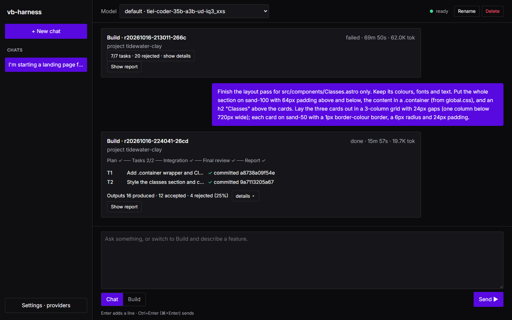

Then the page itself had to be read, because the gates had passed and it still was not right:

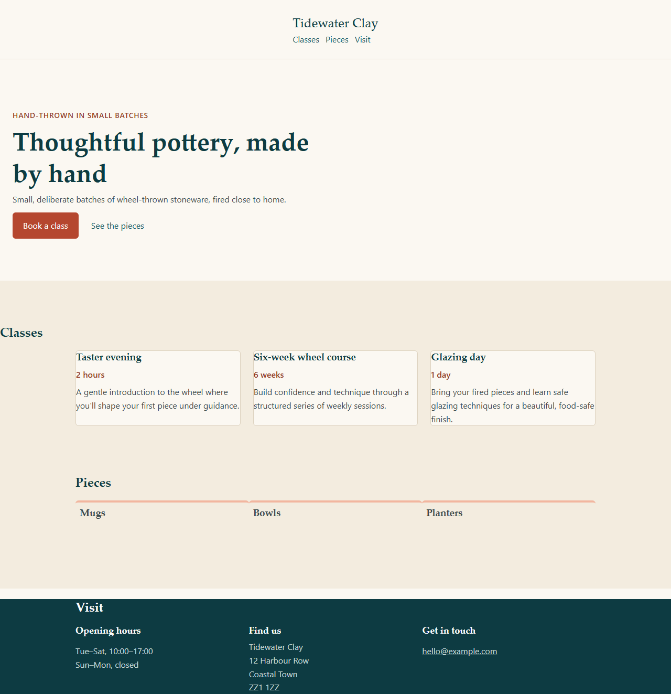

Reading the code behind it found the causes, and two of them are worth knowing about:

- **Invalid CSS passes every gate.** `padding: var(--space-1) * 2;` is not valid CSS (it needs `calc()`), so the
  browser drops the whole declaration. `astro check` checks types and templates, not CSS, so nothing failed. If
  your project has a CSS linter, add it as a gate and this class of mistake is caught at the task that makes it.
- **Layout bugs are about structure.** The header's flex row was on the outer element while the wordmark and nav
  sat inside a container; the hero's width limit was on the section, which kept it at the left edge.

So run 6 was a list of fixes, each naming the cause, one file each:

```text
Fix these layout bugs. Change nothing else.

1. src/components/Header.astro: the flex row is on .header, but the wordmark and the nav are inside .container. Move display: flex, align-items: center and justify-content: space-between from .header to the .container inside it, so the wordmark is on the left and the nav on the right.
2. src/components/Hero.astro: remove max-width from .hero (it keeps the section at the left edge); put max-width: 640px on the hero's text inside the .container instead.
3. src/components/Classes.astro: move the h2 inside the .container, above the grid. "padding: var(--space-1) * 2;" is not valid CSS; write "padding: calc(var(--space-1) * 3);".
4. src/components/Pieces.astro: the section background is sand-50, not sand-100, with 64px padding above and below. Each tile is a sand-100 block 160px tall with a 4px peach-300 top border and a 6px radius, and its caption (the h3) goes below the block, not inside it.
5. src/components/Footer.astro: "padding: var(--space-1) * 8 0;" is not valid CSS; write "padding: calc(var(--space-1) * 8) 0;".
```

Five tasks, all committed, in 50 minutes.

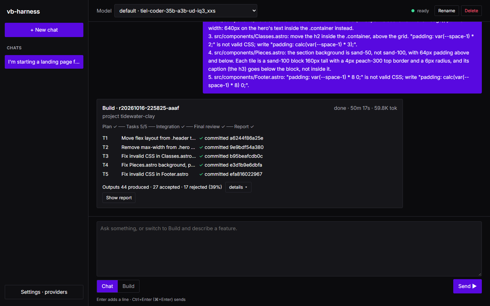

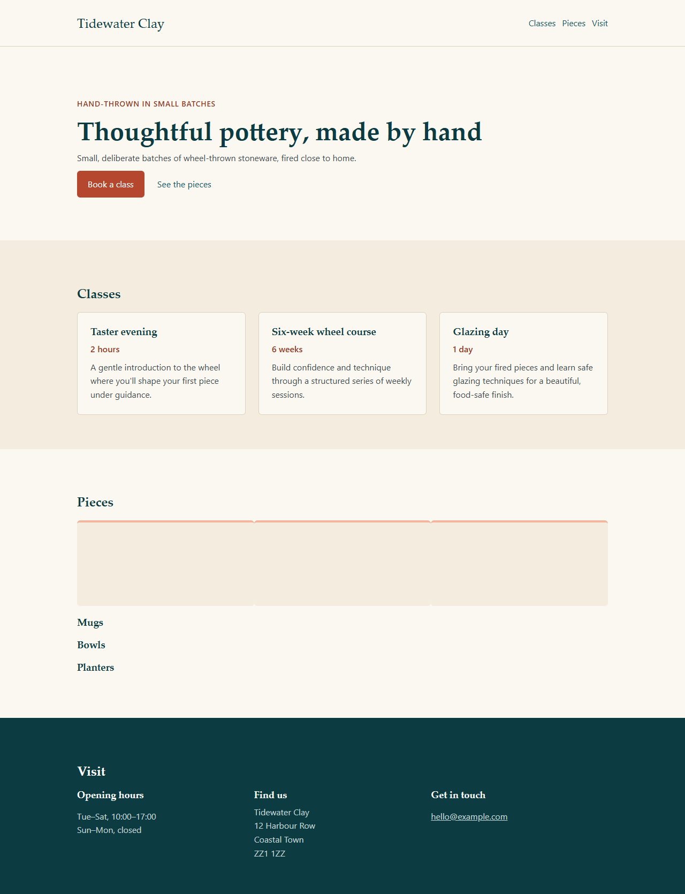

One thing was left: the three piece captions were stacked under the row of tiles instead of each under its own.
Run 7 was one sentence for one file:

```text
In src/components/Pieces.astro, each caption belongs under its own tile. Put each tile block and its h3 caption together in one grid item, so the grid shows three columns of tile-plus-caption with 24px gaps between them (one column below 720px wide). Change nothing else.
```

Two tasks, both committed, in 10 minutes. It read "together in one grid item" literally and put each caption
inside its tile, at the top, and the 24px gaps between the tiles still are not there. That is where this recipe
stops: the page is right in content, colour, type and layout, and works on a phone; the tiles would be one more
sentence, worded more exactly ("under the tile, not inside it").


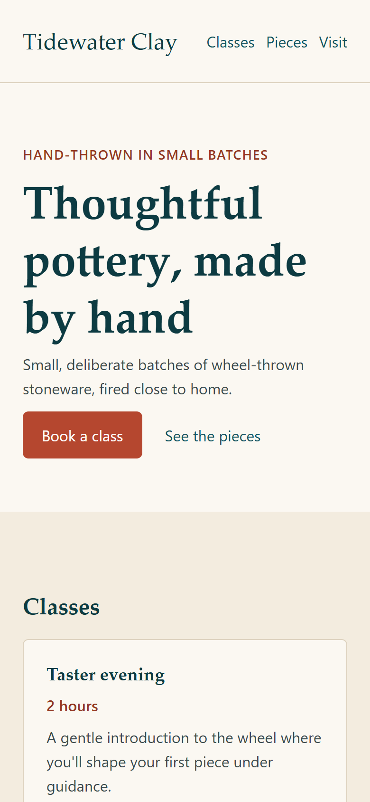

| | Run 5 | Run 6 | Run 7 |
| --- | --- | --- | --- |
| Tasks | 2 done | 5 done | 2 done |
| Model outputs | 16 produced, 4 rejected (25%) | 44 produced, 17 rejected (39%) | 16 produced, 4 rejected (25%) |
| Tokens | 19.7K | 59.8K | 18.4K |
| Wall time | 16 min | 50 min | 10 min |

Small, exact requests are where a small local model does best: fewer files in its context, fewer edits to get
right, and less for the review to argue about. Compare run 3's 51% rejected outputs with run 5's 25%.

## 12. Review and merge

The harness never touches your checkout. Every committed task is a commit on the run's branch, in a worktree of
its own, so reviewing is ordinary git:

```bash
git log --oneline main..harness/RUN_ID
git diff main...harness/RUN_ID
```

After all seven runs were merged, the project's history is one commit per task, each named after the task the
planner wrote, on top of the two set-up commits:

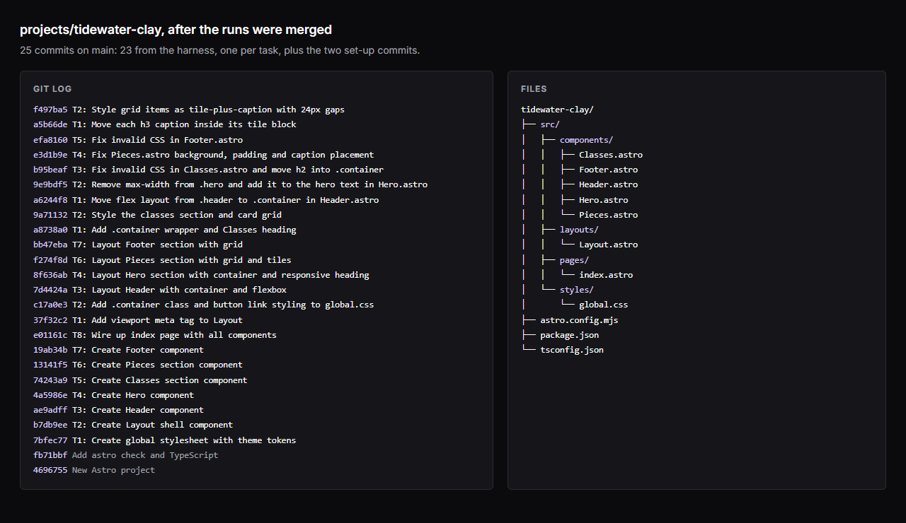

Merge it when it is right:

```bash
git merge harness/RUN_ID
```

Then run the site yourself:

```bash
npm run build
npm run preview
```

## 13. What to take from this

- **Settle questions in Chat, then write an exact Build request.** Values, wording, file paths and what each file
  imports. The planner keeps what you write; it cannot keep what you did not.
- **Give the harness checks that prove something.** `astro check` turns "it builds" into "it type-checks".
- **Read the plan's questions and the model's contradictions.** A small model can be confidently inconsistent.
- **Read the diff before merging, and look at the page.** Gates catch broken code, not the wrong page, and not
  CSS the browser silently drops. Add a CSS linter as a gate if you have one.
- **Iterate in small requests.** A layout pass after a content pass is cheaper and clearer than one request that
  tries to get everything right.
- **Expect rejections.** With a 16K model, between a quarter and more than half of the model's outputs were thrown
  away in each run (fewer in the small ones). That is the harness doing its job: each one was caught, explained in
  the report, and asked again.
